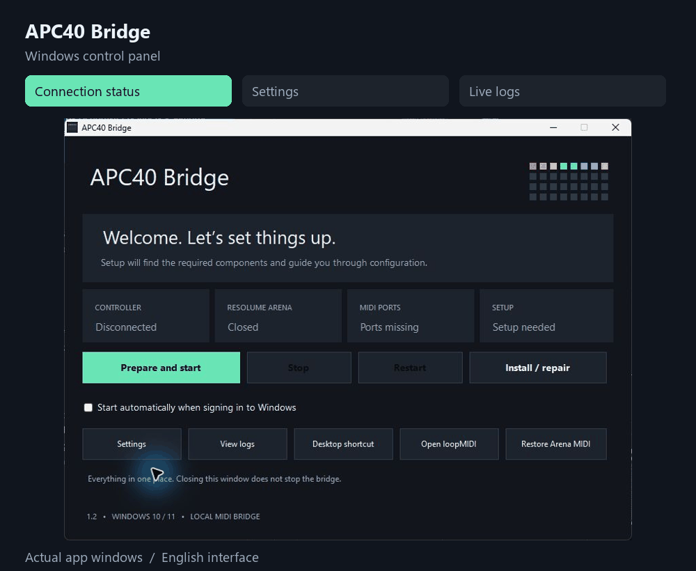
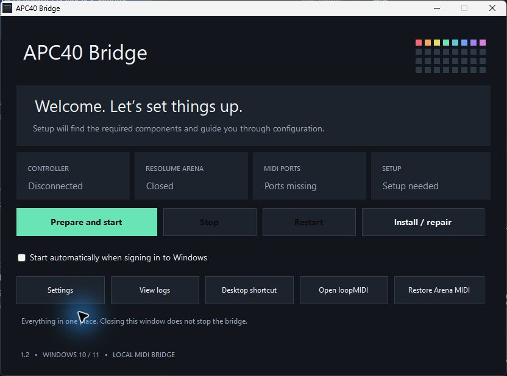
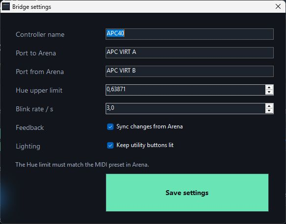
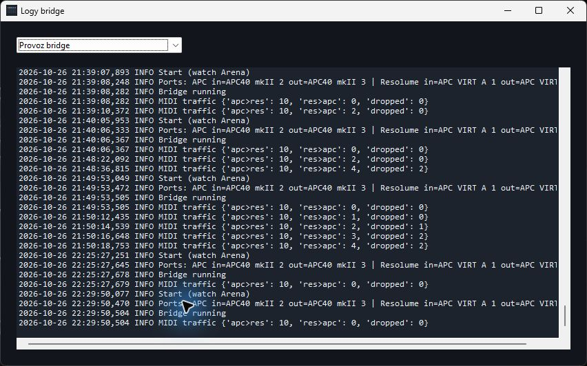
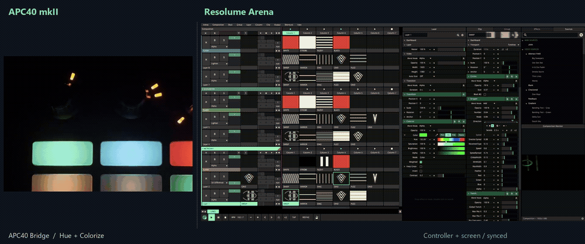
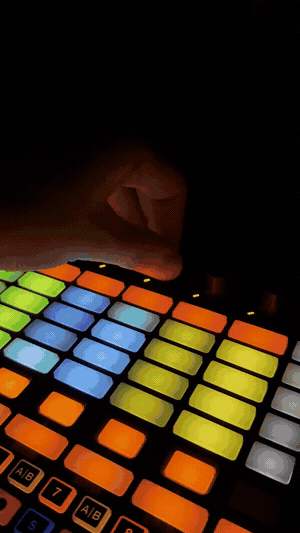

# APC40 mkII ⇄ Resolume Arena bridge

[English](README.md) | **Česky**

Barevné pady pod Hue knoby, tlačítka viditelná ve tmě a **jedno okno pro instalaci, spuštění a správu**.

- Pad ukazuje odstín knobu; stisk přepíná Colorize.
- Volitelná MIDI zpětná vazba přijímá změny z Areny i jiných ovladačů.
- Bridge se aktivuje s Arenou a uvolní kontroler po jejím zavření.
- Aplikace ukazuje stav kontroleru, Areny, portů a instalace. Bez terminálového okna.

  

Skutečné snímky Windows aplikace · přehled, nastavení a logy v jednom okně

## Ukázky aplikace

<table>
  <tr>
    <td width="33%" align="center"></td>
    <td width="33%" align="center"></td>
    <td width="33%" align="center"></td>
  </tr>
  <tr>
    <td align="center"><b>Přehled připojení</b></td>
    <td align="center"><b>Nastavení</b></td>
    <td align="center"><b>Provozní logy</b></td>
  </tr>
</table>

Kliknutím otevřeš snímek v plné velikosti.

Rozhraní aplikace je anglicky; názvy tlačítek v tomto návodu odpovídají aplikaci.

## Experimentální macOS verze

Samostatná [testovací verze pro Mac](https://github.com/Technical223/apc40-resolume-bridge/tree/main/macos) používá nativní IAC/CoreMIDI, jednoduché menu, tříminutový test a diagnostický ZIP. Je nepodepsaná, vyžaduje Python a ruční MIDI nastavení. Fyzický APC s Arenou na Macu ještě musí ověřit tester. [České pokyny](https://github.com/Technical223/apc40-resolume-bridge/blob/main/macos/TESTER-CS.md). Windows aplikace zůstává oddělená.

## Začni tady — Windows

1. Rozbal balíček **APC40-Bridge-Windows.zip** do složky, kde má zůstat. Při prvním nastavení zavři Arenu.
2. Otevři **APC40 Bridge.exe**.
3. Klikni **Prepare and start**. Příprava najde nebo nainstaluje potřebné součásti.
4. Pokud chybí virtuální porty, klikni **Open loopMIDI**, vytvoř **APC VIRT A** a **APC VIRT B** a přípravu zopakuj.
5. V Areně vyber MIDI preset na **Any device** a nastav Hue **Range Max 0,63871** (zobrazuje se zaokrouhleně 0,64).

Pro další použití stačí aplikace a tlačítko **Start bridge**. Volba **Start automatically when signing in to Windows** spustí bridge bez otevírání správce.

**Stažený zdrojový ZIP z GitHubu:** ve složce `bridge` otevři **APC40 Bridge.vbs**. Ten připraví aplikaci z přiložených zdrojů a otevře stejné okno. Není k tomu potřeba Python ani další vývojové nástroje; sestavení používá .NET Framework ve Windows.

## Vše na jednom místě

| Ovládání | Co dělá |
|---|---|
| Start bridge | Spustí hlídání Areny; při opakovaném spuštění nevytváří další proces |
| Zastavit / Restartovat | Bezpečně uvolní kontroler nebo načte nové nastavení |
| Install / repair | Připraví závislosti a MIDI nastavení; běžící bridge zbytečně nerestartuje |
| Settings | Porty, Hue, zpětná vazba a osvětlení; zachová ostatní hodnoty a uloží zálohu |
| View logs | Provoz, příprava i správa přímo v aplikaci |
| Desktop shortcut | Přidá běžnou ikonu aplikace na plochu |
| Restore Arena MIDI | Při zavřené Areně vrátí zálohu MIDI nastavení, zastaví bridge a vypne autostart |

Zavření správce **nezastaví** bridge. Běží samostatně na pozadí. Restart může do Areny znovu přenést fyzické polohy faderů/knobů.

## Bridge v akci

  

Stejný okamžik ze tří pohledů · APC40 mkII + Colorize + Composition Monitor · <a href="docs/media/controller-screen-sync.mp4">Přehrát 36s video v plné kvalitě (MP4)</a>

Záběry jsou časově srovnané podle změn Hue. Vlevo je skutečný kontroler, uprostřed detail panelu Colorize s hodnotou Hue a vpravo výřez Composition Monitoru. Video ukazuje změny odstínu a přepínání Colorize, bez zvuku.

Původní krátká ukázka kontroleru

  

<a href="docs/media/demo.mp4">Přehrát původní ukázku APC40 v plné kvalitě</a>

## Zpětná vazba LED

`sync_resolume_feedback: true` v `config.json` zapíná stávající MIDI zpětnou vazbu. Hue CC 48–55 aktualizují odstín, noty 32–39 stav Colorize. Arena je musí odesílat do `APC VIRT B`; pro aktuální preset platí velocity **5 = aktivní efekt, 3 = bypass**.

Jde o 7bitovou MIDI hodnotu v rozsahu nastaveného presetu, nikoli plně přesné čtení přes API. Mimo rozsah `0–hue_max` není správný odstín zaručen. Režim lze vypnout v **Nastavení → Zpětná vazba**. Webserver ani další knihovna nejsou potřeba.

👉 **[Podrobný návod, nastavení a řešení problémů](docs/navod.cs.md)**

Pro další vývoj: [kontext a ověření změn](CLAUDE.md), [technický popis aplikace](docs/windows-app.cs.md).

Původní dávkové soubory zůstávají pro kompatibilitu; `START.bat` nyní otevře správce.

MIT · [Technical223](https://github.com/Technical223)
