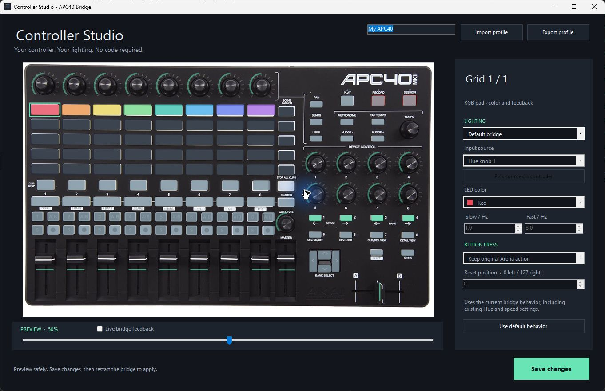
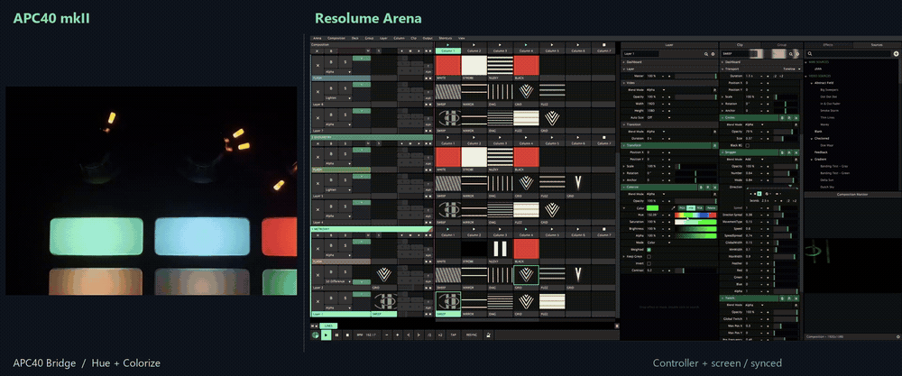
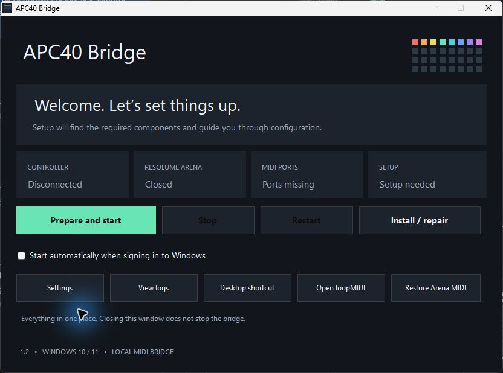
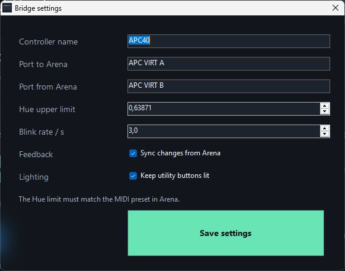
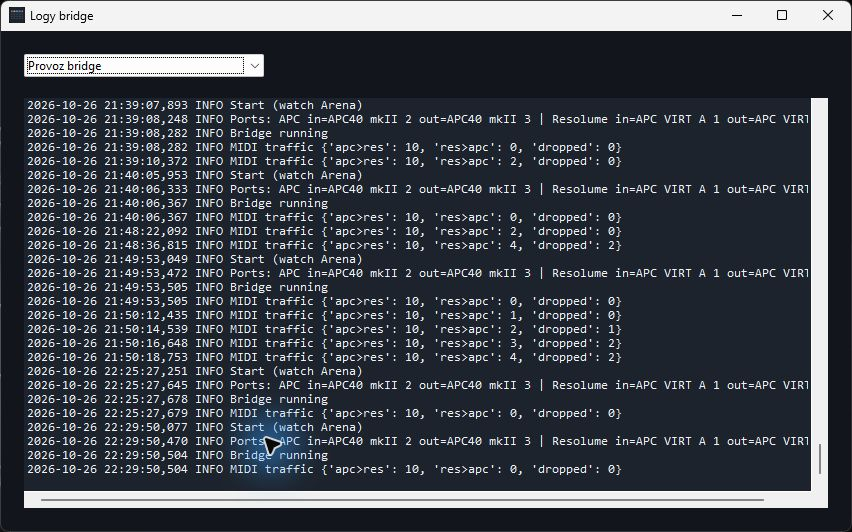
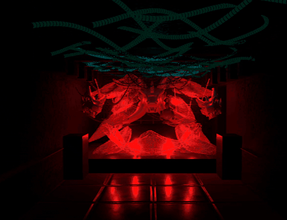

# APC40 mkII ⇄ Resolume Arena bridge

[English](README.md) | **Česky**

Windows aplikace pro osvětlení APC40 mkII a MIDI zpětnou vazbu z Resolume Areny. Pady ukazují odstín Colorize, změny myší se mohou přenášet na kontroler a Controller Studio umožňuje nastavit světla a resety bez úprav kódu. Rozhraní aplikace je anglicky.

## Vývojová verze: vše v jednom okně

Aktuální vývojová větev otevírá **Visualizer / Output mapping / 3D Editor** přímo v Bridge přes Microsoft WebView2. Stabilní stažení níže tuto změnu zatím neobsahuje. **Workspace** umožní přenést lokální projekty z původního prohlížeče; původní data zůstanou zachována. [Postup a plán rendereru (anglicky)](docs/native-visualizer.md).

Hledám spolupracovníky na grafiku, Spout, C#, macOS a testování; vítaný je i vývoj s pomocí AI. [Jak se zapojit](CONTRIBUTING.md#build-the-next-version-together).

## Stažení a spuštění

1. Stáhni **[APC40-Bridge-Setup.exe](https://github.com/Technical223/apc40-resolume-bridge/releases/latest)**. Při první instalaci zavři Arenu, při aktualizaci i bridge aplikaci.
2. Klikni **Install**. Python a MIDI knihovny jsou přibalené. Chybějící loopMIDI instalátor stáhne od autora; jeho licenci a oprávnění Windows potvrdíš ručně.
3. Otevři **APC40 Bridge → Start bridge**, potom Arenu. Porty **APC VIRT A** a **APC VIRT B** se připraví automaticky.

Potřebuješ Windows 10/11 x64, Resolume Arena 7.x a APC40 mkII. Instalátor není digitálně podepsaný. [Přenosný ZIP, offline instalace a aktualizace (anglicky)](docs/windows-installation.md).

## Nastavení Areny

V **Preferences → MIDI** nastav:

| Zařízení | MIDI Input | MIDI Output |
|---|---|---|
| APC VIRT A | Zapnuto | Vypnuto |
| APC VIRT B | Vypnuto | Zapnuto |
| Fyzické APC40 mkII | **Zapnuto** | **Zapnuto** |

Clock Input nech vypnutý a u fyzického APC vyber **Alternate Ableton Live Mode**. Ověřené zapojení potřebuje zapnutý fyzický vstup i výstup.

Shortcuty přijímají z **Any device** nebo **APC VIRT A**, feedback posílají do **APC VIRT B** nebo **All devices**. Hue Range Max nastav na **0.63871**, stejně jako ve výchozí konfiguraci bridge. [Návod a referenční screenshot](docs/navod.cs.md#midi-předvolby-areny).

## Controller Studio

Klikni na ovladač na fotce, vyber barvu, blikání, zdrojový knob/fader nebo reset. Vyzkoušej náhled, ulož profil a restartuj bridge. **Live bridge feedback** ukazuje výstup běžícího bridge. [Návod k editoru (anglicky)](docs/controller-studio.md).

Volitelná **Speed buttons** blikají pod knoby 5–8; stisk s přiloženým mapováním vrací rychlost grupy na **1×**. Experimentální animaci ringů nech vypnutou kvůli rušení hodnot knobů. [Nastavení speed tlačítek](docs/navod.cs.md#blikání-speed-tlačítek-a-reset-na-1).

## Ukázka

[36sekundové video](docs/media/controller-screen-sync.mp4) · [Prohlídka aplikace](docs/media/app-showcase.gif) · [Původní ukázka kontroleru](docs/media/demo.mp4)

<table>
  <tr>
    <td width="33%" align="center"></td>
    <td width="33%" align="center"></td>
    <td width="33%" align="center"></td>
  </tr>
  <tr>
    <td align="center"><b>Přehled připojení</b></td>
    <td align="center"><b>Nastavení</b></td>
    <td align="center"><b>Provozní logy</b></td>
  </tr>
</table>

## Běžné použití a pomoc

- **Start bridge**, **Stop** a **Restart** ovládají bridge na pozadí. Zavření hlavního okna ho nezastaví.
- **Settings** obsahuje zpětnou vazbu a automatické spuštění po přihlášení. **View logs** zobrazí záznamy chyb.
- Spuštění nebo restart může přenést fyzické polohy knobů/faderů do Areny; MIDI learning nech vypnutý.

[Nastavení a řešení problémů](docs/navod.cs.md) · [Instalace (anglicky)](docs/windows-installation.md) · [Controller Studio (anglicky)](docs/controller-studio.md)

[Experimentální verze pro macOS](macos/README.md) je nepodepsaná, potřebuje Python a ruční nastavení IAC; Controller Studio neobsahuje. Čeká na ověření s hardwarem.

Pro vývojáře: [sestavení aplikace](docs/windows-app.cs.md) · [kontext projektu](CLAUDE.md). Ze zdrojového ZIPu lze otevřít **bridge/APC40 Bridge.vbs**; pro běžné použití doporučujeme instalátor.

MIT · [Technical223](https://github.com/Technical223), s AI asistencí **Anthropic Claude** a **OpenAI ChatGPT/Codex** · [Jak přispět (anglicky)](CONTRIBUTING.md) · [Bezpečnost](SECURITY.md)

## Novinky ve verzi 1.5

Vizualizér umí **presety prostoru**: v jednom náhledu přepínáš mezi několika místnostmi nebo variantami rigu. **LED** prostor ukazuje jen LED. **Projekční** prostor LED skryje a z pletiv v místnosti udělá ploché projekční desky se stejným obrysem, na kterých je kompozice. Obojí je jen náhled a nemění výstupy Areny. Nastavení přes `spaces.json` popisuje [návod k vizualizéru (anglicky)](docs/visualizer.md#space-presets). Ve verzi 1.5.1 se už nic nepromítá na pletivo.

## Novinky ve verzi 1.4

Přehled, Controller Studio, nastavení a logy jsou v jednom okně. Vizualizér nabízí editor výstupů, fixtures a jednotlivých pixelů podle uloženého Advanced Outputu. Výběr se ukládá pro každý preset zvlášť a nemění nastavení Areny. [Návod k vizualizéru (anglicky)](docs/visualizer.md).
