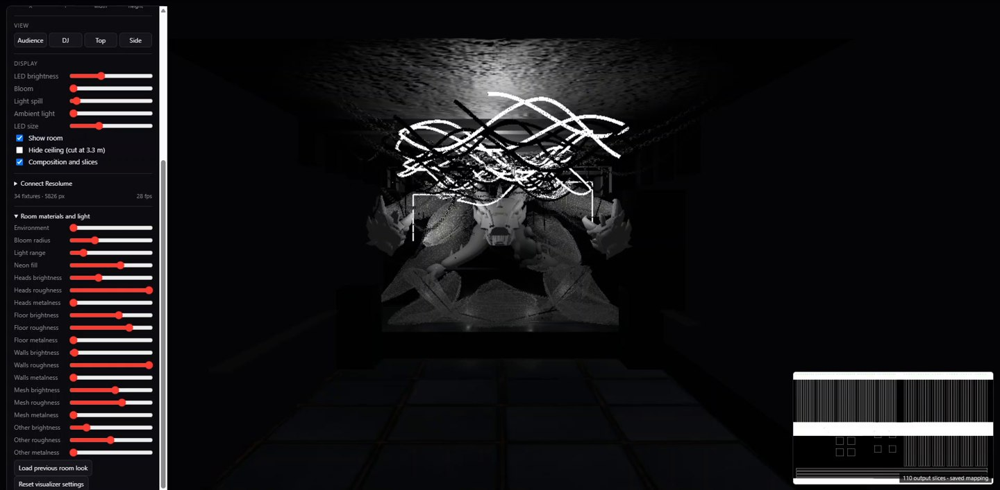
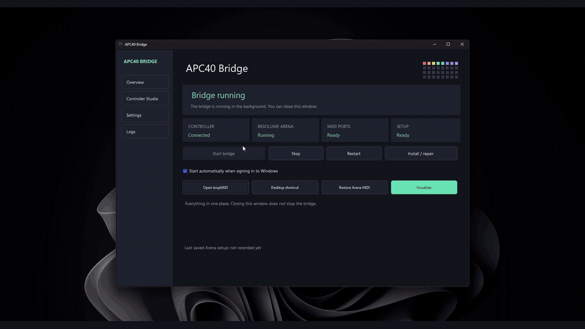
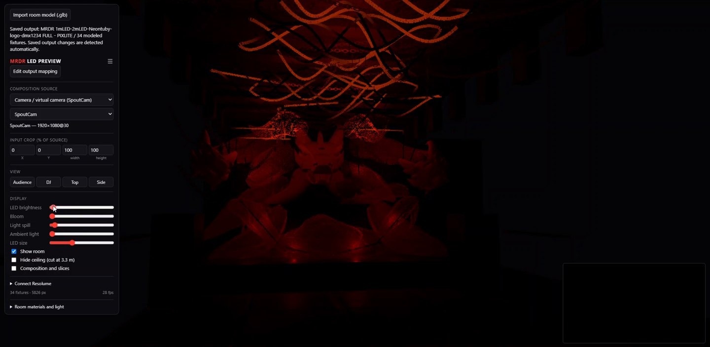
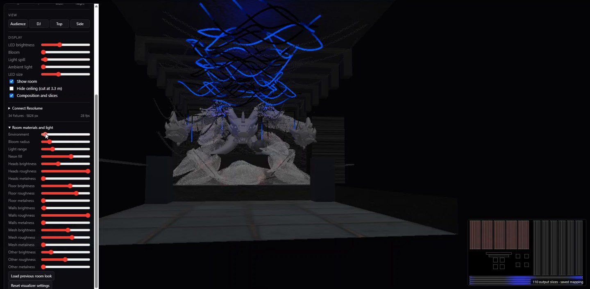
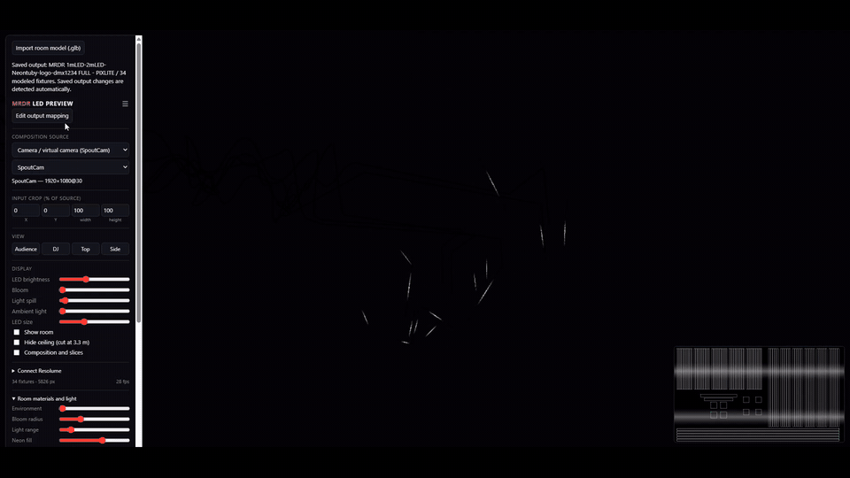
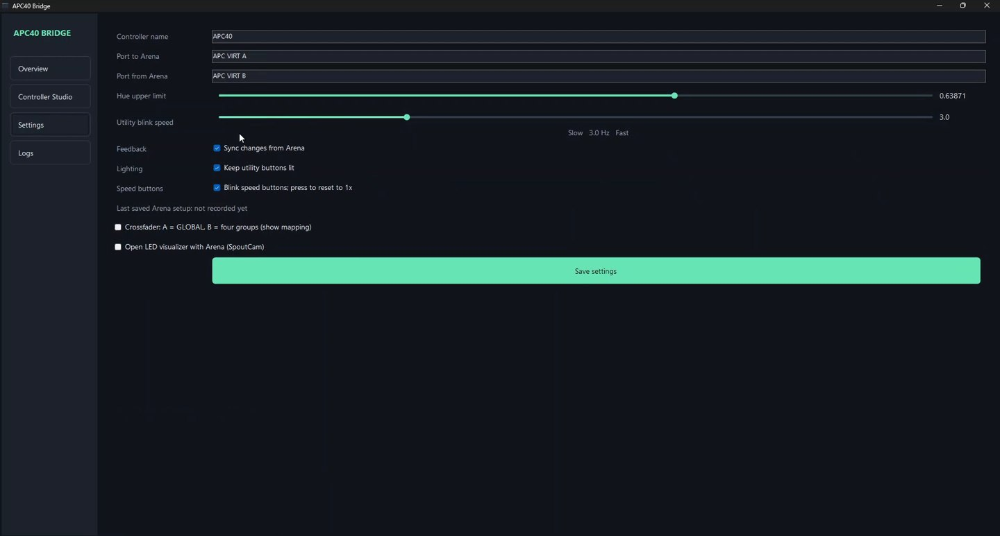

# APC40 Bridge

### Your controller. Your colors. Your stage.

MIDI feedback, a visual controller editor and an optional LED preview for **Akai APC40 mkII + Resolume Arena**.

**[Download for Windows](https://github.com/Technical223/apc40-resolume-bridge/releases/latest)** · [Quick setup](#get-started) · [Česky](README.cs.md)

*An example installation using a custom room model. Your show can look different.*

## See what you play

Pads follow Colorize Hue, and supported changes made with the mouse update the controller too. Keep your Arena mappings; let Bridge handle the lighting and feedback.

## Make the APC yours

Click a control in **Controller Studio**. Choose its color, blink speed, source fader or reset action. Changes save automatically and update a running bridge—no code editing.

*Simulate a value to try a rule, or switch to Live bridge feedback to see the bridge’s output.*

## Open your stage

Click **Visualizer** on the dashboard to open the optional browser preview. Adjust the room, camera and lighting without changing Arena’s outputs.

<table>
<tr>
<td width="50%"></td>
<td width="50%"></td>
</tr>
<tr><td align="center">See the room</td><td align="center">See your content</td></tr>
</table>

*The public app includes a small generic room. The custom show model pictured here is not bundled.*

<strong>Connect Arena or bring your own room</strong>

1. Save your **Advanced Output** preset in Arena and enable the composition’s **Spout output** on Windows.
2. Enable the visualizer in Bridge Settings. Camera setup downloads SpoutCam from its publisher and verifies its checksum. Confirm Windows administrator and browser camera prompts; OBS is not required.
3. Open **Visualizer** and select **SpoutCam**. The source should match Arena’s composition.
4. Use **Import room model** to load a local **GLB** for the current session. Export your Blender project as glTF Binary (`.glb`) first.

A room mesh provides the scenery. Positioned 3D LEDs additionally need a matching `physical-layout.json`; importing a room does not position fixtures automatically. The 2D output editor works without it. Saved Advanced Output changes refresh about every ten seconds; unsaved edits are not read.

The preview uses your GPU. Close it when Arena needs those resources; large room models can still be demanding. [Full visualizer guide](docs/visualizer.md).

## Choose what appears

Open **Edit output mapping**, then select outputs, fixtures or individual pixels. Names and Lumiverse IDs come from saved Advanced Output. Your selection saves per preset and affects only the preview.

<strong>Watch the full clips</strong>

[Controller Studio](docs/media/showcase/02_controller-studio.mp4) · [LED preview](docs/media/showcase/04_led-preview-neon-orange.mp4) · [Output editor](docs/media/showcase/08_output-editor.mp4)

## Get started

**Windows 10/11 x64 · Resolume Arena 7.x · APC40 mkII**

1. **Download and install.** Get **APC40-Bridge-Setup.exe** from the Windows download above. Close Arena for first setup and Bridge before updating. Python and MIDI libraries are included.
2. **Prepare the ports.** Setup prepares **APC VIRT A** and **APC VIRT B**. If loopMIDI is missing, setup downloads its installer from the publisher; you confirm its license and Windows permission prompts.
3. **Start Bridge, then Arena.** In Arena’s **Preferences → MIDI**, use this tested Windows routing:

| Device | MIDI Input | MIDI Output |
|:---|:---:|:---:|
| APC VIRT A | On | Off |
| APC VIRT B | Off | On |
| Physical APC40 mkII | **On** | **On** |

Keep **Clock Input off** and select **Alternate Ableton Live Mode** for the physical APC. Both physical input and output are required in this tested setup.

Shortcuts receive from **Any device** or **APC VIRT A** and send feedback to **APC VIRT B** or **All devices**. Set Colorize **Hue Range Max to 0.63871** to match the default bridge configuration.

<strong>Installation, offline use and everyday controls</strong>

- The installer is unsigned; Windows may show a publisher warning. Confirm installation only if you trust the download.
- First-time loopMIDI and optional SpoutCam setup require internet access and your confirmation. The public installer is not a fully offline bundle and does not include Arena or show media.
- **Start**, **Stop** and **Restart** manage the background bridge. Closing the Windows dashboard leaves it running.
- Starting or restarting may send physical knob/fader positions to Arena. Keep MIDI learning off.
- Optional **Speed buttons** below knobs 5–8 reset their groups to **1×** with the supplied mapping. Leave experimental ring animation off to avoid interference.
- **Settings** contains feedback, lighting and sign-in startup. **Logs** helps diagnose connections.

[Installation and portable/offline options](docs/windows-installation.md) · [Routing and troubleshooting](docs/navod.md) · [Controller Studio reference](docs/controller-studio.md)

## Mac testers welcome

macOS support is experimental. The dashboard preview is being developed with the same main pages and shared controller profiles; it is not yet a verified replacement for the Windows build.

**Diagnostics stay local. Nothing is uploaded automatically.** Review the generated ZIP and share it manually with your feedback if you choose.

See [macOS test builds and setup](macos/README.md) for the available version, requirements and limitations. Mac capture differs from Windows; SpoutCam is Windows-only.

---

Created and maintained by [Technical223](https://github.com/Technical223), with AI-assisted development by **OpenAI Codex**. MIT licensed.

Development and credits

[Windows build notes](docs/windows-app.md) · [Project context](CLAUDE.md) · [Media credits](docs/media/showcase/README.md)

