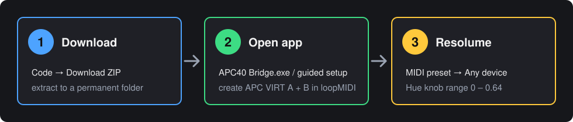

# APC40 mkII ⇄ Resolume Arena bridge

Barevné pady pod hue knoby a tlačítka, která svítí i ve tmě. Pro **Akai APC40 mkII** a **Resolume Arena 7**.

- 🎨 **Pad ukazuje barvu**, kterou právě dává hue knob nad ním (stisk = colorize on/off).
- 💡 **Tlačítka svítí pořád**, aktivní funkce bliká.
- 🔄 **Sám se zapne s Arenou** a vypne, když ji zavřeš.

Otočíš knobem → změní se barva vrstvy v Resolume i padu pod knobem. Bez koukání do počítače víš, jakou barvu která vrstva má.

▶ [video ve vyšší kvalitě](docs/media/demo.mp4)

 

## Záměrné omezení LED

Horní barevná řada sleduje polohy knobů a stisky padů na APC40. Změna Hue nebo zapnutí/vypnutí Colorize **myší v Resolume ani načtení jiné kompozice nemusí aktualizovat tyto LED**. Zpětná vazba Resolume pro noty 32–39 se záměrně zahazuje, aby nepřepsala vlastní barvy bridge. Bílá znamená místní stav „Colorize vypnutý“, nikoli potvrzení stavu v Resolume. Toto chování je zamýšlené a zůstává zachováno. Podrobnosti jsou v [návodu](docs/navod.md#záměrné-omezení-synchronizace-horní-řady).

## Instalace

1. **Code → Download ZIP**, rozbal.
2. Zavři Arenu a spusť **`bridge\START.bat`**. Až se otevře loopMIDI, přidej porty `APC VIRT A` a `APC VIRT B`.
3. V Resolume dej MIDI preset na **Any device** a hue knobům **Range 0 – 0,64**.

Hotovo. Pro autostart s Windows spusť `AUTOSTART_ZAPNOUT.bat`.

👉 **[Podrobný návod s obrázky, nastavení a řešení problémů](docs/navod.md)**

## Soubory ve složce `bridge`

| Soubor | Co dělá |
|---|---|
| `START.bat` | instalace a spuštění |
| `STOP.bat` | zastavení |
| `AUTOSTART_ZAPNOUT.bat` / `_VYPNOUT.bat` | spouštění s Windows |
| `LADENI.bat` | běh s výpisem, když něco nejede |
| `VRATIT_RESOLUME.bat` | vrátí původní MIDI nastavení Resolume |
| `config.json` | porty, barvy, rozsah hue ([popis](docs/navod.md#5-nastavení-bridge-configjson)) |

---

<b>English</b>

A small MIDI bridge between an Akai APC40 mkII and Resolume Arena 7 on Windows. The top grid row shows the current hue of the track knob above it (press = colorize on/off), single-colour buttons stay lit and blink while active, and the bridge starts and stops itself with Arena.

Run `bridge\START.bat` (installs Python, mido/python-rtmidi and loopMIDI; create ports `APC VIRT A` and `APC VIRT B`), set your Resolume MIDI preset to *Any device* and limit the hue knobs' Range Max to 0.63871 (= `hue_max` in `config.json`; use 1 / 1.0 for the full hue circle).

MIT · [Technical223](https://github.com/Technical223)
