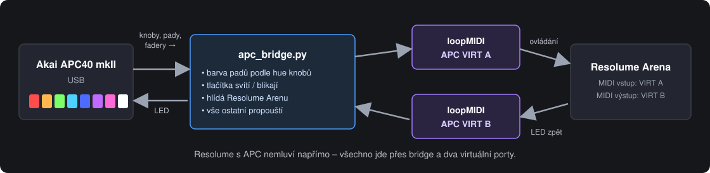
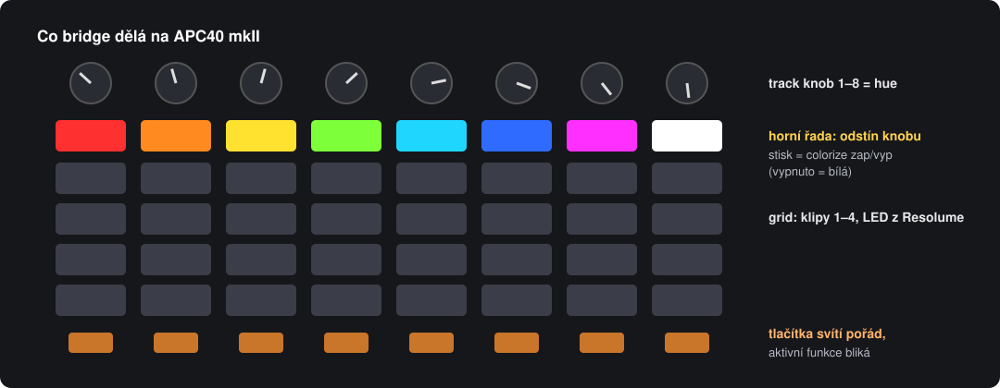
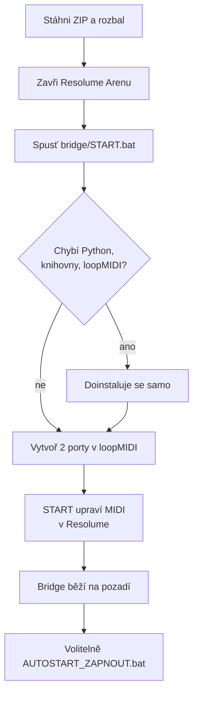
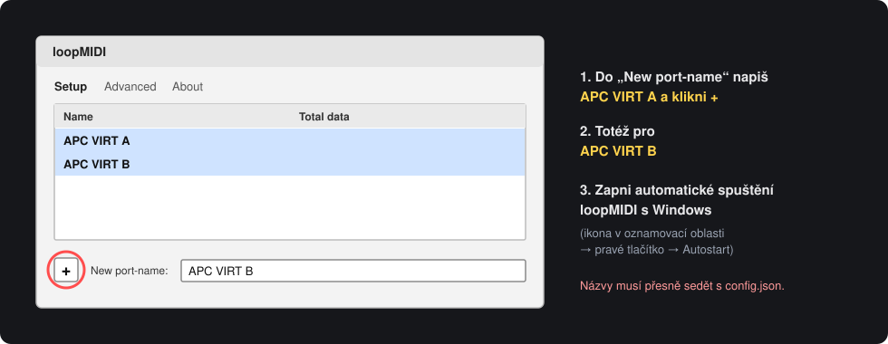
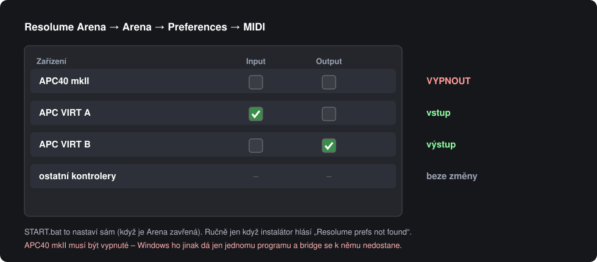
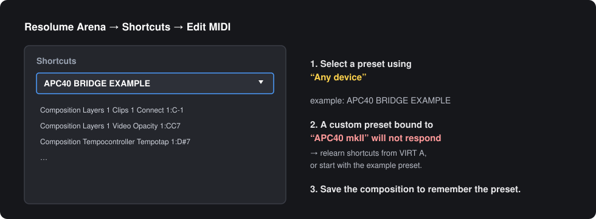

# APC40 mkII ⇄ Resolume Arena bridge

Malý MIDI prostředník mezi **Akai APC40 mkII** a **Resolume Arena 7** (Windows), který přidá to, co Resolume sám neumí:

- 🎨 **Barevné pady pod hue knoby**: horní řada gridu svítí odstínem, který dává track knob nad ní. Stisk padu zapne/vypne colorize, vypnuto = bílá.
- 💡 **Tlačítka svítí pořád**: jednobarevná tlačítka jdou najít i ve tmě, aktivní funkce bliká.
- 🔄 **Hlídá Arenu**: běží na pozadí bez okna. APC převezme, když spustíš Arenu, a pustí ho, když ji zavřeš. Po vytažení kabelu se sám znovu připojí.
- ⚡ **Instalace jedním kliknutím**: `START.bat` doinstaluje Python, knihovny i loopMIDI a nastaví Resolume.

Všechno ostatní (fadery, knoby, grid, LED klipů) prochází beze změny. Funguje s jakýmkoli MIDI mappingem v Resolume, který je nastavený na **libovolné zařízení**.

---

## Obsah
1. [Co potřebuješ](#1-co-potřebuješ)
2. [Instalace krok za krokem](#2-instalace-krok-za-krokem)
3. [Nastavení v Resolume](#3-nastavení-v-resolume)
4. [Každodenní použití](#4-každodenní-použití)
5. [Nastavení bridge (config.json)](#5-nastavení-bridge-configjson)
6. [Řešení problémů](#6-řešení-problémů)
7. [Nouzový režim a odinstalace](#7-nouzový-režim-a-odinstalace)

---

## 1. Co potřebuješ

| | Verze | Poznámka |
|---|---|---|
| Windows | 10 / 11 | 64 bit |
| Resolume Arena | 7.x | testováno 7.25 |
| Akai APC40 mkII | – | připojený přes USB |
| Python | 3.9+ | **nainstaluje se sám**, když chybí (3.12) |
| [loopMIDI](https://www.tobias-erichsen.de/software/loopmidi.html) | – | **nainstaluje se sám** přes winget; zdarma pro nekomerční použití |
| Internet | – | jen při první instalaci |

## 2. Instalace krok za krokem

### Krok 1: Stažení
Na této stránce **Code → Download ZIP**, rozbal kamkoli (např. `Dokumenty\APC40 Bridge`). Složku můžeš později přesunout, pak jen znovu spusť `START.bat` (a `AUTOSTART_ZAPNOUT.bat`, pokud autostart používáš).

### Krok 2: Zavři Resolume Arenu
Resolume si nastavení MIDI při zavření přepisuje, proto je instalátor upravuje jen při zavřené Areně.

### Krok 3: Spusť `bridge\START.bat`
Otevře se okno PowerShellu a postupně:
1. najde nebo nainstaluje **Python 3.12** (jen pro tvého uživatele),
2. nainstaluje knihovny **mido** a **python-rtmidi**,
3. najde nebo nainstaluje **loopMIDI** a spustí ho.

> Když Windows SmartScreen ukáže „Systém Windows ochránil počítač“, klikni **Další informace → Přesto spustit**. Skript nic nestahuje odjinud než z python.org, PyPI a winget.

### Krok 4: Porty v loopMIDI (jediný ruční krok, jednou na každém PC)

| Port | K čemu |
|---|---|
| `APC VIRT A` | bridge → Resolume (ovládání) |
| `APC VIRT B` | Resolume → bridge (LED zpět na APC) |

Názvy musí přesně odpovídat `config.json`. Instalátor počká, až porty uvidí (max. 5 minut). Nezapomeň na **Autostart loopMIDI**, jinak porty po restartu PC nebudou.

### Krok 5: MIDI v Resolume (udělá START sám)
START přepne `Dokumenty\Resolume Arena\Preferences\midi.xml` takto a původní soubor zálohuje jako `midi.xml.pred-bridge.bak`:

### Krok 6: Hotovo
Na konci vyskočí „Hotovo. Bridge běží na pozadí…“. Bridge teď čeká na spuštění Areny.

**Autostart (doporučeno):** spusť `bridge\AUTOSTART_ZAPNOUT.bat`. Bridge se pak spustí po přihlášení do Windows a ty už jen zapínáš Arenu.

## 3. Nastavení v Resolume

- **MIDI preset musí být nastavený na libovolné zařízení.** Preset vázaný na „APC40 mkII“ přes virtuální port nereaguje, protože Resolume teď vidí jen `APC VIRT A`.
- **Ukázkový preset `APC40 BRIDGE EXAMPLE`** instalátor nakopíruje do `Dokumenty\Resolume Arena\Shortcuts\MIDI`. Rozložení kompozice, se kterým počítá, je v [`docs/layout.md`](docs/layout.md).
- **Vlastní mapping:** v *Shortcuts → Edit MIDI* shortcuty přeuč. Učí se z `APC VIRT A`, to je v pořádku.
- **Horní řada gridu (noty 32–39)** má v presetu přepínač colorize vrstvy. Barvu padu kreslí bridge, Resolume do ní nemluví.
- **Track knoby (CC 48–55)** mají v presetu hue colorize, rozsah 0–0,6387 (červená → zelená → modrá).
- **Ulož kompozici.** Vybraný MIDI preset se pamatuje v ní.

## 4. Každodenní použití

| Situace | Co dělat |
|---|---|
| Autostart zapnutý | jen zapni Arenu, APC se během pár sekund rozsvítí |
| Bez autostartu | `START.bat`, pak Arena |
| Chci APC použít v jiném programu | zavři Arenu (bridge APC pustí) nebo `STOP.bat` |
| Něco nejede | `LADENI.bat` (nejdřív `STOP.bat`) ukáže porty a chyby v okně |

**Po startu bridge** APC pošle polohy všech faderů a knobů a Resolume je hned převezme. Fader, který je fyzicky dole, stáhne vrstvu na nulu.

### Co znamenají LED
| Tlačítko | Svítí | Bliká |
|---|---|---|
| Horní řada gridu | odstín knobu nad ní | – (bílá = colorize vypnutý) |
| Jednobarevná tlačítka | funkce připravená | funkce je aktivní (flash drží, efekt zapnutý, klip hraje…) |
| Mute tlačítka (`lit_invert`) | normální stav | ztlumeno |
| Grid (klipy) | podle tvého presetu v Resolume | – |

## 5. Nastavení bridge (`config.json`)

| Klíč | Výchozí | Význam |
|---|---|---|
| `to_resolume_port` / `from_resolume_port` | `APC VIRT A` / `APC VIRT B` | názvy loopMIDI portů |
| `apc_port_match` | `APC40` | část názvu fyzického APC ve Windows |
| `arena_process` | `Arena.exe` | proces, který bridge hlídá |
| `knob_ccs` | 48–55 | track knoby, ze kterých se bere odstín |
| `color_notes` | 32–39 | pady, které odstín ukazují |
| `hue_max` | 0.6387 | horní mez hue (stejná jako rozsah knobu v Resolume) |
| `palette` | 11 barev | úhel odstínu → číslo barvy APC |
| `white_velocity` | 3 | barva padu při vypnutém colorize |
| `always_lit` | `true` | jednobarevná tlačítka svítí trvale |
| `lit_track_notes` / `lit_global_notes` | viz soubor | která tlačítka svítí |
| `lit_invert` | mute tlačítka | „svítí“ = normální stav, bliká při ztlumení |
| `blink_hz` | 3 | rychlost blikání |
| `apc_mode` | 66 | režim APC (0x42 Alternate Ableton); zkus 65, kdyby něco nereagovalo |

Po změně `config.json` spusť znovu `START.bat`.

## 6. Řešení problémů

| Příznak | Příčina | Řešení |
|---|---|---|
| Instalátor čeká na porty | v loopMIDI chybí porty nebo mají jiný název | vytvoř `APC VIRT A` a `APC VIRT B` přesně takto |
| APC nesvítí vůbec | bridge neběží nebo Arena neběží | `bridge.log`; `START.bat`; zapni Arenu |
| `bridge.log`: „Waiting for ports“ | APC není připojený nebo ho drží jiný program | zapoj USB; v Resolume vypni APC40 mkII; zavři Ableton a podobně |
| Knoby/pady v Resolume nic nedělají | MIDI preset je vázaný na „APC40 mkII“ | preset na libovolné zařízení (kap. 3) |
| Resolume nevidí `APC VIRT A` | loopMIDI neběží | spusť loopMIDI, zapni jeho autostart |
| Hlášení „Resolume Arena běží“ | instalátor nemůže měnit nastavení za běhu | zavři Arenu a spusť `START.bat` znovu |
| Jiný kontroler (APC20…) spouští totéž | preset „libovolné zařízení“ slyší všechny vstupy | v *Preferences → MIDI* ten kontroler vypni |
| Pad má jinou barvu než vrstva | pad ukazuje polohu knobu, hue jsi měnil myší | otoč knobem |

Logy: `bridge\bridge.log` (běh) a `bridge\setup.log` (instalace).

## 7. Nouzový režim a odinstalace

**Nouzový režim (bridge nejede na akci):**
1. `STOP.bat`
2. Arena → *Preferences → MIDI*: zapni **APC40 mkII** (Input i Output)
3. preset na libovolné zařízení funguje dál, jen bez barevné horní řady a svítících tlačítek

**Odinstalace:**
1. `AUTOSTART_VYPNOUT.bat` a `STOP.bat`
2. `VRATIT_RESOLUME.bat` (Arena zavřená) vrátí původní MIDI nastavení
3. smaž složku; Python a loopMIDI odinstaluj ve Windows, pokud je nepotřebuješ

---

### English summary
A small MIDI bridge between an Akai APC40 mkII and Resolume Arena 7 on Windows. The top grid row shows the current hue of the track knob above it (press = colorize on/off), single-colour buttons stay lit and blink while active, and the bridge starts and stops itself with Arena. `bridge\START.bat` installs everything it needs (Python, mido/python-rtmidi, loopMIDI) and switches Resolume's MIDI input/output to two loopMIDI ports (`APC VIRT A` → Resolume, `APC VIRT B` ← Resolume). Your Resolume MIDI preset must be set to *any device*. Options live in `bridge\config.json`.

License: MIT
