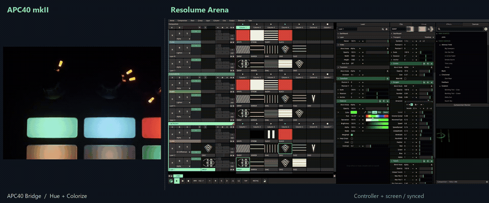
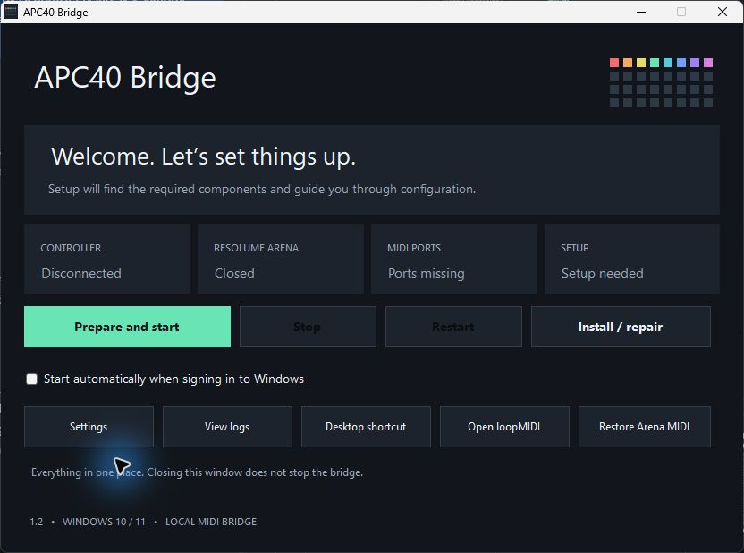
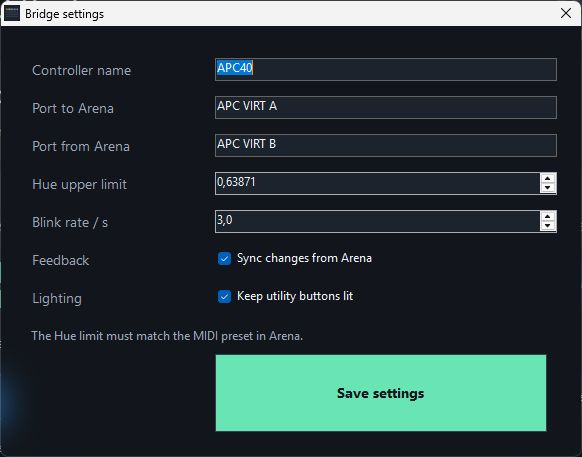
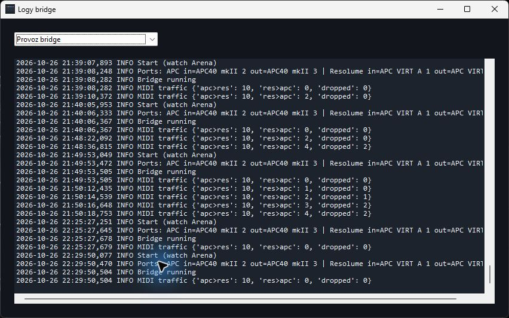

# APC40 mkII ⇄ Resolume Arena bridge

**English** | [Česky](README.cs.md)

Windows app for APC40 mkII lighting and MIDI feedback in Resolume Arena. Pads follow Colorize Hue, mouse edits can update the controller, and Controller Studio lets you customize lighting and button resets without editing code.

## Download and start

1. Download **[APC40-Bridge-Setup.exe](https://github.com/Technical223/apc40-resolume-bridge/releases/latest)**. Close Arena for first setup and close the bridge app before updating.
2. Click **Install**. Python and MIDI libraries are included. If loopMIDI is missing, setup downloads it from the publisher; confirm its license and Windows permission prompts.
3. Open **APC40 Bridge → Start bridge**, then Arena. Setup prepares **APC VIRT A** and **APC VIRT B** automatically.

Requires Windows 10/11 x64, Resolume Arena 7.x and an APC40 mkII. The installer is unsigned. [Portable ZIP, offline use and updates](docs/windows-installation.md).

## Arena setup

In **Preferences → MIDI**, use:

| Device | MIDI Input | MIDI Output |
|---|---|---|
| APC VIRT A | On | Off |
| APC VIRT B | Off | On |
| Physical APC40 mkII | **On** | **On** |

Keep Clock Input off and select **Alternate Ableton Live Mode** for the physical APC. Both physical input and output are needed in the tested setup.

Shortcuts receive from **Any device** or **APC VIRT A** and send feedback to **APC VIRT B** or **All devices**. Set Hue Range Max to **0.63871** to match the default bridge configuration. [Setup guide and reference screenshot](docs/navod.md#arena-midi-preferences).

## Controller Studio

Click a control on the photo to choose its color, blink rate, source knob/fader or reset action. Preview locally, save a profile and restart the bridge to apply it. **Live bridge feedback** shows the running bridge's output. [Editor guide](docs/controller-studio.md).

Optional **Speed buttons** blink beneath knobs 5–8; pressing one resets its group to **1x** with the supplied mapping. Leave experimental ring animation off to avoid knob interference. [Speed-button setup](docs/navod.md#speed-buttons-blink-rate-and-1x-reset).

## See it in action

[Watch the 36-second video](docs/media/controller-screen-sync.mp4) · [App tour](docs/media/app-showcase.gif) · [Original controller demo](docs/media/demo.mp4)

<table>
  <tr>
    <td width="33%" align="center"></td>
    <td width="33%" align="center"></td>
    <td width="33%" align="center"></td>
  </tr>
  <tr>
    <td align="center"><b>Connection status</b></td>
    <td align="center"><b>Settings</b></td>
    <td align="center"><b>Live logs</b></td>
  </tr>
</table>

## Everyday use and help

- **Start bridge**, **Stop** and **Restart** manage the background bridge. Closing the dashboard does not stop it.
- **Settings** includes feedback and sign-in autostart. **View logs** helps diagnose connection problems.
- Starting or restarting can send physical knob/fader positions to Arena; keep MIDI learning off.

[Setup and troubleshooting](docs/navod.md) · [Windows installation](docs/windows-installation.md) · [Controller Studio](docs/controller-studio.md)

[Experimental macOS preview](macos/README.md): unsigned, requires Python and manual IAC setup; no Controller Studio. Hardware testing is still needed.

For developers: [build notes](docs/windows-app.md) · [project context](CLAUDE.md). Source ZIP users can open **bridge/APC40 Bridge.vbs**; the setup EXE is recommended for normal use.

MIT · [Technical223](https://github.com/Technical223)
