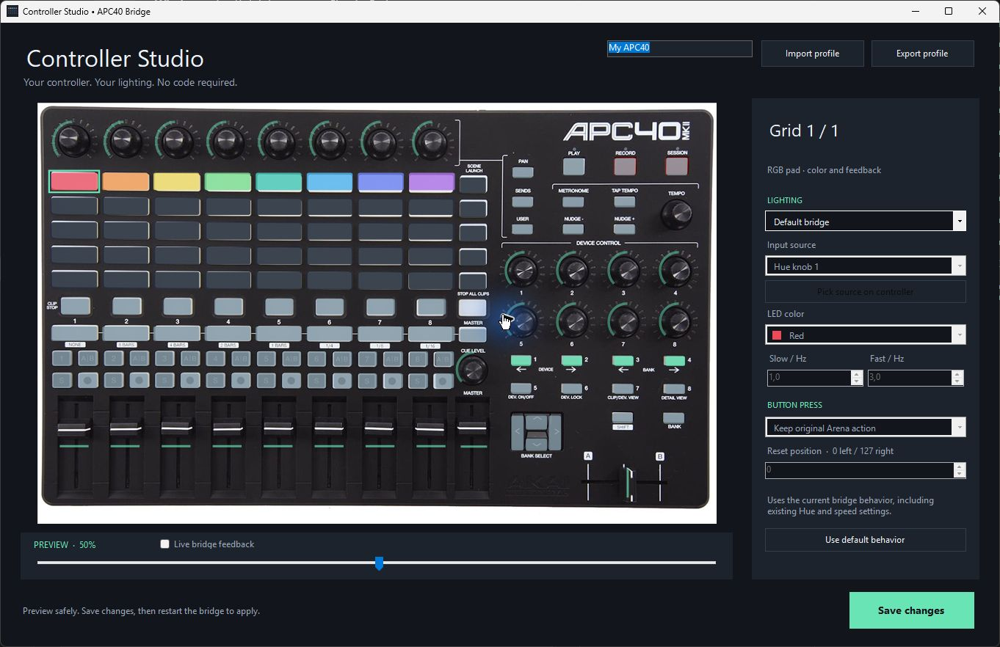

# Controller Studio

[Home](../README.md) · [Setup guide](navod.md)

Controller Studio is the Windows app's visual editor for bridge lighting and button resets. It has an offline simulation and a read-only live view. Edits save automatically after a short pause and update the running bridge without restarting it. The Preview slider only simulates source values and sends no MIDI.

## Build a lighting profile

1. Open **APC40 Bridge → Controller Studio**.
2. Click a grid pad or utility button in the controller diagram.
3. Choose its **Lighting** behavior.
4. Choose an **Input source**, or click **Pick source on controller** and then click a knob or fader in the diagram.
5. Set its color or drag the Slow → Fast speed sliders. Blink uses one fixed rate; Speed indicator follows its source between the minimum and maximum rates. RGB pads support palette colors; utility buttons retain their hardware's single-color LED.
6. Keep **Button press → Keep original Arena action**, or explicitly choose **Reset source value**.
7. Move the **Preview** slider to simulate the source position.
8. Name your profile. Changes save automatically and reach a running bridge within about two seconds. **Save now** saves immediately; **Close** finishes pending changes and closes Studio. If the bridge is stopped, start it from the dashboard.

The photo's clickable controls match the APC40 mkII layout. Standard encoder ring feedback remains unchanged.

## Live view

Enable **Live bridge feedback** to display the LED Note values and source CC positions observed by the running bridge. This reads a small local snapshot file; the editor never opens another MIDI connection. The view reflects bridge output, not optical measurement of physical LEDs. Custom palette colors are approximated on screen.

The bridge must be running and connected. If it stops or the snapshot becomes stale, Studio shows an offline/waiting state instead of presenting simulated values as live. Turn Live off to return to the preview slider. Live view shows bridge output as saved edits are applied.

Live view updates at up to 10 Hz while requested; it stops writing snapshots when unused. It shows bridge output rather than an exact measurement of LED blink timing.

## Behaviors

| Lighting | Result |
|---|---|
| Default bridge | Preserve existing bridge behavior, including Hue/Colorize and enabled speed buttons |
| LED off | Hold this LED off without removing its original Arena button action |
| Solid light | Hold a palette color on an RGB pad, or light a utility button |
| Follow Hue | Map a knob/fader value to the existing Hue palette; RGB pads only |
| Follow level (on / off) | Light when the source CC is above zero |
| Blink | Blink at the configured slow rate |
| Speed indicator | Increase blink rate between Slow and Fast as the source moves from left to right |

Blink rates are limited to 0.2–5 Hz, with a default 1–3 Hz range. Speed indication follows the MIDI shortcut position; it is not an exact measurement of Arena's nonlinear playback-speed curve.

**Follow Hue** uses the bridge's existing Hue upper limit and palette. Mouse changes follow when **Settings → Sync changes from Arena** is on and Arena sends the matching source CC feedback to the bridge.

Custom lighting takes ownership of only the selected LED. Incoming Arena colors and the older bridge blinkers cannot overwrite it. Unchanged LED frames are not resent. Lighting animation uses Note messages; it never writes animated values into knob CCs.

## Button resets

**Reset source value** consumes the selected button's press and release and sends one absolute CC value to its linked source. Holding the button does not repeat the reset. The existing button action is replaced only when this reset action is explicitly selected. Lighting-only overrides keep the built-in speed-button reset when enabled.

Reset position is the source's MIDI position: **0** is its left endpoint, **127** its right endpoint. With the supplied speed mapping, **0 selects 1x** and **127 selects 10x**. This is not universal: another mapping can use different endpoints. Physical faders are not motorized and do not move when reset.

## Save and share

Automatic saving updates only the lighting rules and profile name, preserves unrelated configuration, and makes one timestamped backup per editor session. It disables legacy ring animation to prevent encoder interference. If another process changes the configuration while Studio is open, saving stops and asks you to reopen it.

**Export profile** saves a named, versioned JSON profile. **Import profile** loads it into the preview; it is saved and applied after the same short pause. Profiles contain custom lighting rules, not MIDI port settings, Arena shortcuts, or the global legacy bridge settings.

Two examples are included in the app's **profiles** folder:

- **Default bridge.json** clears the custom overrides and returns every control to its existing bridge behavior.
- **Fader colors.json** links the top eight RGB pads to the eight track faders without changing their Arena actions.

Choose **Use default behavior** to remove only the selected control's override. Closing saves any pending edits. Import or use the saved backup to restore earlier settings.

## Platform and performance

Studio is Windows-only and uses the dashboard's native .NET UI. The photo is cached, minimized previews pause, and live snapshots stop when unused. Static rules need no animation worker. Test new mappings on your controller; performance in Arena depends on your composition and hardware.

[Windows installation](windows-installation.md) · [Akai APC40 mkII MIDI protocol](https://cdn.inmusicbrands.com/akai/attachments/apc40II/APC40Mk2_Communications_Protocol_v1.2.pdf)
