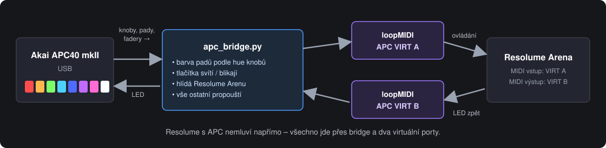
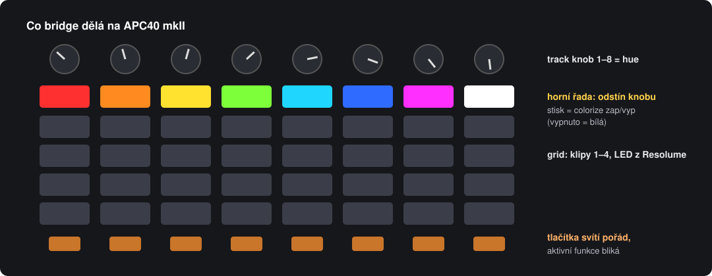
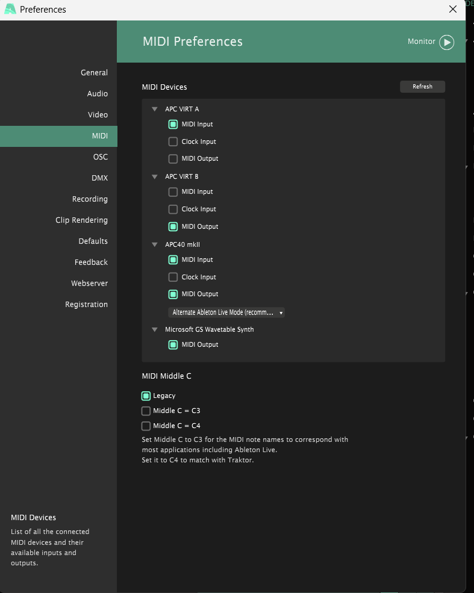
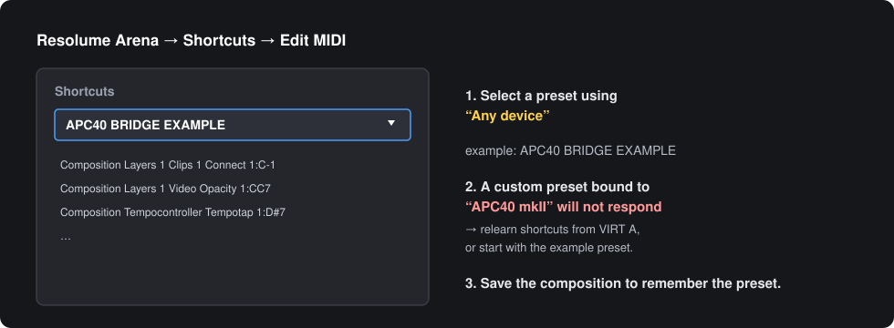
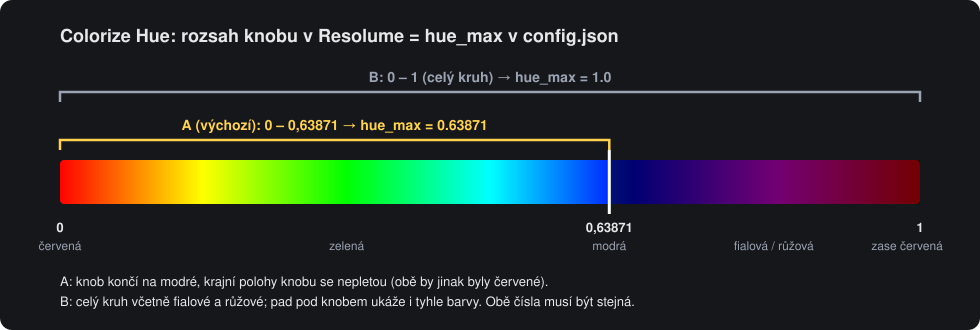
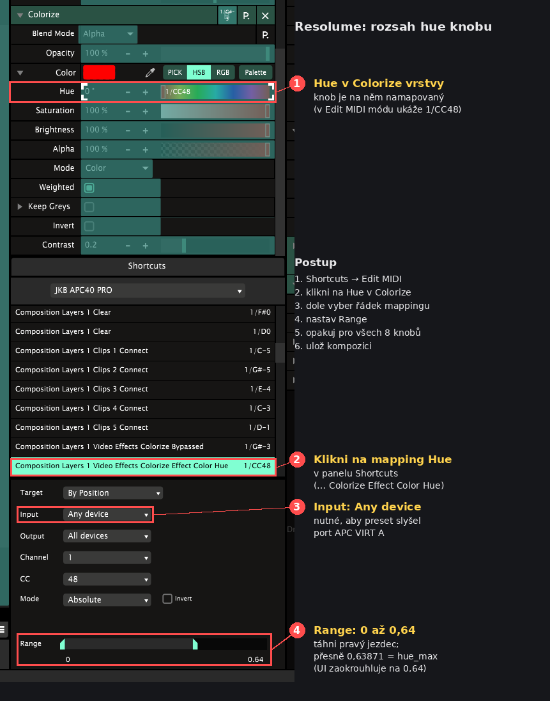

# Podrobný návod

[English](navod.md) | **Česky** · [Hlavní stránka](../README.cs.md)

## Obsah
1. [Co potřebuješ](#1-co-potřebuješ)
2. [Instalace a spuštění](#2-instalace-a-spuštění)
3. [Nastavení v Resolume](#3-nastavení-v-resolume)
4. [Každodenní použití](#4-každodenní-použití)
5. [Nastavení bridge (config.json)](#5-nastavení-bridge-configjson)
6. [Řešení problémů](#6-řešení-problémů)
7. [Nouzový režim a odinstalace](#7-nouzový-režim-a-odinstalace)

---

## 1. Co potřebuješ

Windows 10/11 x64, Resolume Arena 7.x (testováno 7.25) a Akai APC40 mkII přes USB. Instalátor obsahuje Python a MIDI knihovny. Chybějící [loopMIDI](https://www.tobias-erichsen.de/software/loopmidi.html) stáhne od autora; licenci a oprávnění Windows potvrdíš ručně.

## 2. Instalace a spuštění

Postup pro instalátor, přenosný ZIP, offline provoz a aktualizace najdeš v [instalačním návodu (anglicky)](windows-installation.md). Instalátor připraví **APC VIRT A** (bridge → Arena) a **APC VIRT B** (Arena → bridge), zachová profily a zálohuje MIDI nastavení Areny.

Pokud loopMIDI běželo bez těchto portů, jednou ho restartuj. Otevři **APC40 Bridge → Start bridge**, potom Arenu. **Install / repair** zopakuje přípravu; potřebuje-li upravit MIDI předvolby, zavři Arenu.

**Start automatically when signing in to Windows** spouští bridge bez hlavního okna. Po přesunu přenosné instalace volbu vypni a zapni kvůli aktualizaci zástupce. **View logs** zobrazí provozní a instalační záznamy.

## 3. Nastavení v Resolume

### MIDI předvolby Areny

Otevři **Arena → Preferences → MIDI**. Při používání bridge nastav:

| Zařízení | MIDI Input | Clock Input | MIDI Output |
|---|---|---|---|
| APC VIRT A | Zapnuto | Vypnuto | Vypnuto |
| APC VIRT B | Vypnuto | Vypnuto | Zapnuto |
| APC40 mkII (fyzický USB kontroler) | Zapnuto | Vypnuto | Zapnuto |

U fyzického **APC40 mkII ponech MIDI Input i MIDI Output zapnuté** a vyber **Alternate Ableton Live Mode** (66 / 0x42). V ověřeném zapojení po vypnutí fyzických portů zpětná vazba nefunguje.

**Install / repair** zachovává vybraný režim kontroleru. Po první instalaci zkontroluj **Alternate Ableton Live Mode** ručně.

**MIDI Middle C:** referenční screenshot používá **Legacy**. Tato volba mění pouze zobrazované názvy not, ne jejich MIDI čísla. Ostatní zařízení ponech podle svého zapojení; Microsoft GS Wavetable Synth bridge nepotřebuje.

Shortcuty mají přijímat z **Any device** nebo **APC VIRT A** a posílat zpětnou vazbu do **All devices** nebo **APC VIRT B**. Pokud reset vrátí kontroler, ale v Areně zůstane stará hodnota, po spuštění loopMIDI vypni a znovu zapni **APC VIRT A → MIDI Input**.

Referenční screenshot: kde nastavení najít

- **Vstup shortcutů:** vyber **Any device** nebo **APC VIRT A**, aby přijímaly zprávy virtuálního portu bridge.
- **Ukázkový preset `APC40 BRIDGE EXAMPLE`** příprava nakopíruje do `Dokumenty\Resolume Arena\Shortcuts\MIDI`. Rozložení kompozice, se kterým počítá, je v [`docs/layout.md`](layout.cs.md).
- **Vlastní mapping:** v *Shortcuts → Edit MIDI* shortcuty přeuč. Učí se z `APC VIRT A`, to je v pořádku.
- **Horní řada gridu (noty 32–39)** má v presetu přepínač colorize vrstvy. Barvu padu kreslí bridge, který může přijímat zpětnou vazbu Areny.
- **Track knoby (CC 48–55)** mají v presetu hue colorize s rozsahem 0–0,63871 (červená → zelená → modrá), viz níže.
- **Ulož kompozici.** Vybraný MIDI preset se pamatuje v ní.

### Rozsah hue: knob a barva padu musí sedět

Hue v Colorize jde dokola: 0 je červená a 1 je **zase červená**. Když knob mapuješ na celý rozsah, obě krajní polohy dají stejnou barvu a modrá je někde uprostřed. Proto má ukázkový preset knoby omezené na **0–0,63871** (končí na modré).

Bridge počítá barvu padu z MIDI hodnoty knobu nebo zpětné vazby Areny. Proto **musí horní mez v Resolume odpovídat `hue_max` v `config.json`**, jinak pad ukazuje jinou barvu, než jakou má vrstva.

**Kde se mez nastavuje v Resolume:**

1. *Shortcuts → Edit MIDI*.
2. Klikni na parametr **Hue** v efektu Colorize dané vrstvy (ten, na kterém je knob namapovaný, ukazuje `1/CC48` apod.).
3. V panelu **Shortcuts** se vybere řádek `… Video Effects Colorize Effect Color Hue`. Pod ním zkontroluj **Input: Any device**.
4. Dole u **Range** táhni pravý jezdec na **0,64** (Resolume zobrazuje zaokrouhleně; v ukázkovém presetu je přesně 0,63871). Levý zůstává na 0.
5. Totéž pro každý hue knob (všech 8), pak ulož kompozici.

Rozdíl mezi 0,64 a 0,63871 je pod půl stupně odstínu, na barvě padu se neprojeví.

| Chceš | Max v Resolume | `hue_max` v `config.json` |
|---|---|---|
| **A (výchozí)**: červená → modrá, krajní polohy se nepletou | `0.63871` | `0.63871` |
| **B**: celý kruh včetně fialové a růžové | `1` (nech plný rozsah) | `1.0` |
| Vlastní mez | tvoje číslo | stejné číslo |

Po změně nastavení klikni v aplikaci na **Restart**. Pad v režimu B ukazuje i fialovou a růžovou, v obou režimech jde o nejbližší barvu z palety APC (`palette`).

## 4. Každodenní použití

| Situace | Co dělat |
|---|---|
| Autostart zapnutý | jen zapni Arenu, APC se během pár sekund rozsvítí |
| Bez autostartu | aplikace → Start bridge, pak Arena |
| Chci APC použít v jiném programu | zavři Arenu (bridge APC pustí) nebo `STOP.bat` |
| Něco nejede | View logs; případně Install / repair |

**Po startu bridge** APC pošle polohy všech faderů a knobů a Resolume je hned převezme. Fader, který je fyzicky dole, stáhne vrstvu na nulu.

### Co znamenají LED
| Tlačítko | Svítí | Bliká |
|---|---|---|
| Horní řada gridu | odstín knobu nad ní | – (bílá = colorize vypnutý) |
| Jednobarevná tlačítka | funkce připravená | funkce je aktivní (flash drží, efekt zapnutý, klip hraje…) |
| Mute tlačítka (`lit_invert`) | normální stav | ztlumeno |
| Grid (klipy) | podle tvého presetu v Resolume | – |

### Zpětná vazba horní řady

`sync_resolume_feedback: true` zapíná jednoduchou synchronizaci přes již existující MIDI zpětnou vazbu. Arena musí odesílat Hue i Colorize do `APC VIRT B`. Bridge přijme CC 48–55 na kanálu 0 (v Areně kanál 1), uloží hodnotu Hue a přepočítá barvu padu. Změny myší a dalšími ovladači tak mohou aktualizovat stejnou indikaci. Stále se používá `hue_max` podle rozsahu v MIDI presetu.

Stav Colorize se nesmí vyhodnocovat jako `velocity > 0`: tento preset posílá **5 pro aktivní efekt** a **3 pro bypass**. Nastavují to `color_on_feedback_velocity` a `color_off_feedback_velocity`. Bílé LED znamená bypass. Zpětná vazba při opětovném zapnutí vykreslí zapamatovaný odstín, nikoli prostou červenou z presetu. Neočekávané hodnoty a Note Off se ignorují. Bridge nevrací tyto zprávy do Areny, takže nevytváří MIDI smyčku.

Omezení: MIDI má 128 kroků, může hodnotu zaokrouhlit a je omezené rozsahem a směrováním shortcutu. Není to přímé čtení plné hodnoty efektu přes REST/OSC a nic se aktivně nedotazuje; aktualizuje se podle zpráv, které Arena skutečně pošle. Barvy mimo rozsah MIDI shortcutu nemusí odpovídat. Přepnutí kompozice se projeví jen tehdy, pokud nová kompozice používá stejné mapování a pošle zpětnou vazbu. Saturace, jas a opacity se nesledují; pad dál ukazuje plně sytý odstín.

Pokud používáš jiný preset, musí odpovídat CC/noty, kanál, rozsah a hodnoty Colorize. K návratu k původní indikaci pouze z APC nastav `sync_resolume_feedback: false` a restartuj bridge. Při vypnuté synchronizaci bridge horní řadu záměrně odvozuje pouze z fyzických knobů/padů; změny myší ji neaktualizují.

### Obnova při chybě MIDI

Pokud otevření portu selže, bridge zavře již otevřené porty a opakuje připojení. Chyba odesílání v kterémkoli směru nebo ve vlákně blikání označí spojení jako nefunkční; hlavní smyčka je uzavře a zkusí otevřít znovu, i když porty dál figurují v seznamu zařízení. Odpojení USB je stále vhodné ověřit na konkrétním ovladači a zařízení.

`STOP.bat` a restart přes `START.bat` sdílejí `stop_bridge.ps1`. Ten před ukončením ověřuje Python, přesnou cestu tohoto skriptu, režim běhu a čas vzniku procesu. Staré číslo v `bridge.pid` proto samo o sobě nestačí k ukončení jiného programu.

## 5. Nastavení bridge (`config.json`)

| Klíč | Výchozí | Význam |
|---|---|---|
| `to_resolume_port` / `from_resolume_port` | `APC VIRT A` / `APC VIRT B` | názvy loopMIDI portů |
| `apc_port_match` | `APC40` | část názvu fyzického APC ve Windows |
| `arena_process` | `Arena.exe` | proces, který bridge hlídá |
| `knob_ccs` | 48–55 | track knoby, ze kterých se bere odstín |
| `color_notes` | 32–39 | pady, které odstín ukazují |
| `hue_max` | 0.63871 | horní mez hue, **musí se rovnat Max knobu v Resolume**; `1.0` = celý kruh ([Rozsah hue](#rozsah-hue-knob-a-barva-padu-musí-sedět)) |
| `palette` | 14 barev | úhel odstínu → číslo barvy APC (červená → modrá → fialová → růžová) |
| `white_velocity` | 3 | barva padu při vypnutém colorize |
| `sync_resolume_feedback` | `true` v přiloženém configu, jinak `false` | synchronizace Hue/Colorize ze zpětné vazby Areny |
| `color_on_feedback_velocity` / `color_off_feedback_velocity` | 5 / 3 | hodnoty feedbacku pro aktivní Colorize / bypass v tomto presetu |
| `always_lit` | `true` | jednobarevná tlačítka svítí trvale |
| `lit_track_notes` / `lit_global_notes` | viz soubor | která tlačítka svítí |
| `lit_invert` | mute tlačítka | „svítí“ = normální stav, bliká při ztlumení |
| `blink_hz` | 3 | rychlost blikání |
| `apc_mode` | 66 | režim APC (0x42 Alternate Ableton); zkus 65, kdyby něco nereagovalo |

Po změně nastavení klikni v aplikaci na **Restart**.

## 6. Řešení problémů

| Příznak | Příčina | Řešení |
|---|---|---|
| Instalátor čeká na porty | loopMIDI nenačetlo potřebné názvy | restartuj loopMIDI a ověř `APC VIRT A` a `APC VIRT B` |
| APC nesvítí vůbec | bridge neběží nebo Arena neběží | `bridge.log`; `START.bat`; zapni Arenu |
| `bridge.log`: „Waiting for ports“ | APC není připojený nebo ho drží jiný program | zapoj USB; zavři ostatní MIDI aplikace a ověř MIDI předvolby podle návodu výše |
| Knoby/pady v Resolume nic nedělají | MIDI preset je vázaný na „APC40 mkII“ | preset na libovolné zařízení (kap. 3) |
| Resolume nevidí `APC VIRT A` | loopMIDI neběží | spusť loopMIDI, zapni jeho autostart |
| Hlášení „Resolume Arena běží“ | instalátor nemůže měnit nastavení za běhu | zavři Arenu a spusť `START.bat` znovu |
| Jiný kontroler (APC20…) spouští totéž | preset „libovolné zařízení“ slyší všechny vstupy | v *Preferences → MIDI* ten kontroler vypni |
| Pad má jinou barvu než vrstva | chybí MIDI feedback, je vypnutá synchronizace nebo se liší rozsah | ověř `sync_resolume_feedback`, výstup shortcutu do APC VIRT B a stejnou mez `hue_max` ([Rozsah hue](#rozsah-hue-knob-a-barva-padu-musí-sedět)) |
| Knob na konci dá zase červenou | knob mapovaný na plný rozsah 0–1 | Max v Resolume na 0,63871, nebo `hue_max` 1.0 a počítej s tím |

Logy jsou přímo v aplikaci: **View logs → Bridge runtime / Setup / App management**.

## 7. Nouzový režim a odinstalace

Pro přímé ovládání bez osvětlení bridge klikni **Stop**, ponech fyzický MIDI vstup/výstup APC zapnutý a použij preset **Any device**.

Původní MIDI nastavení obnovíš při zavřené Areně tlačítkem **Restore Arena MIDI**. Vrátí zálohu `midi.xml.pred-bridge.bak`, zastaví bridge a vypne jeho autostart. Aplikaci odeber přes Nainstalované aplikace ve Windows; [co zůstane zachováno](windows-installation.md#updates-and-removal).

## Animované ringy rychlosti grup

**Pro běžné použití nech experimentální animaci vypnutou.** Animované CC hodnoty ringů mohou rušit absolutní hodnotu knobu a způsobovat skoky rychlosti.

Volba **Settings → Speed rings → Animate speed rings while idle** nechá tečku běhat první → poslední → první LED. První pohyb animaci pozastaví a obnoví uloženou hodnotu; tento pohyb a krátké ustálení se do Areny neposílají. Další otáčení už prochází. Po sekundě nečinnosti animace pokračuje. Změny myší vyžadují odpovídající MIDI feedback a `sync_resolume_feedback: true`.

Při skocích nastav `speed_ring_animation: false` a restartuj bridge. [Pokročilé parametry (anglicky)](navod.md#idle-only-speed-ring-animation-and-manual-takeover). Test bez hardwaru neprokazuje odstranění rušení encoderu.

## Blikání speed tlačítek a reset na 1×

Zapni **Settings → Speed buttons → Blink speed buttons; press to reset to 1x**, ulož a restartuj. Výchozí stav je vypnuto. Používá **horní** řadu tlačítek pod knoby 5–8: noty **58–61**, párované s CC **20–23**, MIDI kanál 1 (v kódu 0).

Při zapnutí nahrazuje stisk i uvolnění původní akce presetu. Stisk pošle reset do Areny i APC a restartuje fázi bliknutí. Knoby mají běžnou absolutní zpětnou vazbu; změny myší se přebírají, pokud Arena pošle odpovídající feedback.

Přiložené mapování má **1×–10×**: CC **0 = 1×**, CC **127 = 10×**, reset posílá **0**. Blikání roste od **1 do 3 Hz**; ukazuje polohu shortcutu, ne přesnou nelineární rychlost Areny. LED pouze zapíná/vypíná. [Konfigurační hodnoty (anglicky)](navod.md#speed-button-range-correction).

Jiné mapování může potřebovat jinou hodnotu resetu. Speed tlačítka a animace ringů nemohou běžet společně; uložení Settings animaci ringů vypne.

Pokud se APC resetuje, ale číslo v Areně zůstane staré, ověř vstup shortcutu **Any device/APC VIRT A** a výstup **APC VIRT B/All devices**. Po znovuvytvoření portu vypni/zapni jeho MIDI Input v Areně. Fyzický vstup/výstup APC ponech zapnutý podle [MIDI předvoleb](#midi-předvolby-areny); MIDI learning při restartu bridge vypni.

Vlastní světla a resety nastavíš v [Controller Studio (anglicky)](controller-studio.md).
