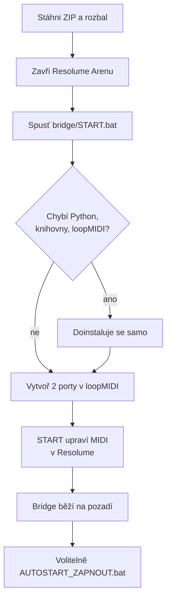

# Podrobný návod

[← zpět na hlavní stránku](../README.md)

## Obsah
1. [Co potřebuješ](#1-co-potřebuješ)
2. [Instalace krok za krokem](#2-instalace-krok-za-krokem)
3. [Nastavení v Resolume](#3-nastavení-v-resolume)
4. [Každodenní použití](#4-každodenní-použití)
5. [Nastavení bridge (config.json)](#5-nastavení-bridge-configjson)
6. [Řešení problémů](#6-řešení-problémů)
7. [Nouzový režim a odinstalace](#7-nouzový-režim-a-odinstalace)

---

## 1. Co potřebuješ

| | Verze | Poznámka |
|---|---|---|
| Windows | 10 / 11 | 64 bit |
| Resolume Arena | 7.x | testováno 7.25 |
| Akai APC40 mkII | – | připojený přes USB |
| Python | 3.9+ | **nainstaluje se sám**, když chybí (3.12) |
| [loopMIDI](https://www.tobias-erichsen.de/software/loopmidi.html) | – | **nainstaluje se sám** přes winget; zdarma pro nekomerční použití |
| Internet | – | jen při první instalaci |

## 2. Instalace krok za krokem

### Krok 1: Stažení
Na této stránce **Code → Download ZIP**, rozbal kamkoli (např. `Dokumenty\APC40 Bridge`). Složku můžeš později přesunout, pak jen znovu spusť `START.bat` (a `AUTOSTART_ZAPNOUT.bat`, pokud autostart používáš).

### Krok 2: Zavři Resolume Arenu
Resolume si nastavení MIDI při zavření přepisuje, proto je instalátor upravuje jen při zavřené Areně.

### Krok 3: Spusť `bridge\START.bat`
Otevře se okno PowerShellu a postupně:
1. najde nebo nainstaluje **Python 3.12** (jen pro tvého uživatele),
2. nainstaluje knihovny **mido** a **python-rtmidi**,
3. najde nebo nainstaluje **loopMIDI** a spustí ho.

> Když Windows SmartScreen ukáže „Systém Windows ochránil počítač“, klikni **Další informace → Přesto spustit**. Skript nic nestahuje odjinud než z python.org, PyPI a winget.

### Krok 4: Porty v loopMIDI (jediný ruční krok, jednou na každém PC)

| Port | K čemu |
|---|---|
| `APC VIRT A` | bridge → Resolume (ovládání) |
| `APC VIRT B` | Resolume → bridge (LED zpět na APC) |

Názvy musí přesně odpovídat `config.json`. Instalátor počká, až porty uvidí (max. 5 minut). Nezapomeň na **Autostart loopMIDI**, jinak porty po restartu PC nebudou.

### Krok 5: MIDI v Resolume (udělá START sám)
START přepne `Dokumenty\Resolume Arena\Preferences\midi.xml` takto a původní soubor zálohuje jako `midi.xml.pred-bridge.bak`:

### Krok 6: Hotovo
Na konci vyskočí „Hotovo. Bridge běží na pozadí…“. Bridge teď čeká na spuštění Areny.

**Autostart (doporučeno):** spusť `bridge\AUTOSTART_ZAPNOUT.bat`. Bridge se pak spustí po přihlášení do Windows a ty už jen zapínáš Arenu.

## 3. Nastavení v Resolume

- **MIDI preset musí být nastavený na libovolné zařízení.** Preset vázaný na „APC40 mkII“ přes virtuální port nereaguje, protože Resolume teď vidí jen `APC VIRT A`.
- **Ukázkový preset `APC40 BRIDGE EXAMPLE`** instalátor nakopíruje do `Dokumenty\Resolume Arena\Shortcuts\MIDI`. Rozložení kompozice, se kterým počítá, je v [`docs/layout.md`](layout.md).
- **Vlastní mapping:** v *Shortcuts → Edit MIDI* shortcuty přeuč. Učí se z `APC VIRT A`, to je v pořádku.
- **Horní řada gridu (noty 32–39)** má v presetu přepínač colorize vrstvy. Barvu padu kreslí bridge, Resolume do ní nemluví.
- **Track knoby (CC 48–55)** mají v presetu hue colorize s rozsahem 0–0,63871 (červená → zelená → modrá), viz níže.
- **Ulož kompozici.** Vybraný MIDI preset se pamatuje v ní.

### Rozsah hue: knob a barva padu musí sedět

Hue v Colorize jde dokola: 0 je červená a 1 je **zase červená**. Když knob mapuješ na celý rozsah, obě krajní polohy dají stejnou barvu a modrá je někde uprostřed. Proto má ukázkový preset knoby omezené na **0–0,63871** (končí na modré).

Bridge Resolume nevidí, jen počítá barvu padu z polohy knobu. Proto **musí horní mez v Resolume odpovídat `hue_max` v `config.json`**, jinak pad ukazuje jinou barvu, než jakou má vrstva.

**Kde se mez nastavuje v Resolume:**

1. *Shortcuts → Edit MIDI*.
2. Klikni na parametr **Hue** v efektu Colorize dané vrstvy (ten, na kterém je knob namapovaný, ukazuje `1/CC48` apod.).
3. V panelu **Shortcuts** se vybere řádek `… Video Effects Colorize Effect Color Hue`. Pod ním zkontroluj **Input: Any device**.
4. Dole u **Range** táhni pravý jezdec na **0,64** (Resolume zobrazuje zaokrouhleně; v ukázkovém presetu je přesně 0,63871). Levý zůstává na 0.
5. Totéž pro každý hue knob (všech 8), pak ulož kompozici.

Rozdíl mezi 0,64 a 0,63871 je pod půl stupně odstínu, na barvě padu se neprojeví.

| Chceš | Max v Resolume | `hue_max` v `config.json` |
|---|---|---|
| **A (výchozí)**: červená → modrá, krajní polohy se nepletou | `0.63871` | `0.63871` |
| **B**: celý kruh včetně fialové a růžové | `1` (nech plný rozsah) | `1.0` |
| Vlastní mez | tvoje číslo | stejné číslo |

Po změně `config.json` spusť znovu `START.bat`. Pad v režimu B ukazuje i fialovou a růžovou, v obou režimech jde o nejbližší barvu z palety APC (`palette`).

## 4. Každodenní použití

| Situace | Co dělat |
|---|---|
| Autostart zapnutý | jen zapni Arenu, APC se během pár sekund rozsvítí |
| Bez autostartu | `START.bat`, pak Arena |
| Chci APC použít v jiném programu | zavři Arenu (bridge APC pustí) nebo `STOP.bat` |
| Něco nejede | `LADENI.bat` (nejdřív `STOP.bat`) ukáže porty a chyby v okně |

**Po startu bridge** APC pošle polohy všech faderů a knobů a Resolume je hned převezme. Fader, který je fyzicky dole, stáhne vrstvu na nulu.

### Co znamenají LED
| Tlačítko | Svítí | Bliká |
|---|---|---|
| Horní řada gridu | odstín knobu nad ní | – (bílá = colorize vypnutý) |
| Jednobarevná tlačítka | funkce připravená | funkce je aktivní (flash drží, efekt zapnutý, klip hraje…) |
| Mute tlačítka (`lit_invert`) | normální stav | ztlumeno |
| Grid (klipy) | podle tvého presetu v Resolume | – |

### Zpětná vazba horní řady

`sync_resolume_feedback: true` zapíná jednoduchou synchronizaci přes již existující MIDI zpětnou vazbu. Arena musí odesílat Hue i Colorize do `APC VIRT B`. Bridge přijme CC 48–55 na kanálu 0 (v Areně kanál 1), uloží hodnotu Hue a přepočítá barvu padu. Změny myší a dalšími ovladači tak mohou aktualizovat stejnou indikaci. Stále se používá `hue_max` podle rozsahu v MIDI presetu.

Stav Colorize se nesmí vyhodnocovat jako `velocity > 0`: tento preset posílá **5 pro aktivní efekt** a **3 pro bypass**. Nastavují to `color_on_feedback_velocity` a `color_off_feedback_velocity`. Bílé LED znamená bypass. Zpětná vazba při opětovném zapnutí vykreslí zapamatovaný odstín, nikoli prostou červenou z presetu. Neočekávané hodnoty a Note Off se ignorují. Bridge nevrací tyto zprávy do Areny, takže nevytváří MIDI smyčku.

Omezení: MIDI má 128 kroků, může hodnotu zaokrouhlit a je omezené rozsahem a směrováním shortcutu. Není to přímé čtení plné hodnoty efektu přes REST/OSC a nic se aktivně nedotazuje; aktualizuje se podle zpráv, které Arena skutečně pošle. Barvy mimo rozsah MIDI shortcutu nemusí odpovídat. Přepnutí kompozice se projeví jen tehdy, pokud nová kompozice používá stejné mapování a pošle zpětnou vazbu. Saturace, jas a opacity se nesledují; pad dál ukazuje plně sytý odstín.

Pokud používáš jiný preset, musí odpovídat CC/noty, kanál, rozsah a hodnoty Colorize. K návratu k původní indikaci pouze z APC nastav `sync_resolume_feedback: false` a restartuj bridge. Při vypnuté synchronizaci bridge horní řadu záměrně odvozuje pouze z fyzických knobů/padů; změny myší ji neaktualizují.

### Obnova při chybě MIDI

Pokud otevření portu selže, bridge zavře již otevřené porty a opakuje připojení. Chyba odesílání v kterémkoli směru nebo ve vlákně blikání označí spojení jako nefunkční; hlavní smyčka je uzavře a zkusí otevřít znovu, i když porty dál figurují v seznamu zařízení. Odpojení USB je stále vhodné ověřit na konkrétním ovladači a zařízení.

`STOP.bat` a restart přes `START.bat` sdílejí `stop_bridge.ps1`. Ten před ukončením ověřuje Python, přesnou cestu tohoto skriptu, režim běhu a čas vzniku procesu. Staré číslo v `bridge.pid` proto samo o sobě nestačí k ukončení jiného programu.

## 5. Nastavení bridge (`config.json`)

| Klíč | Výchozí | Význam |
|---|---|---|
| `to_resolume_port` / `from_resolume_port` | `APC VIRT A` / `APC VIRT B` | názvy loopMIDI portů |
| `apc_port_match` | `APC40` | část názvu fyzického APC ve Windows |
| `arena_process` | `Arena.exe` | proces, který bridge hlídá |
| `knob_ccs` | 48–55 | track knoby, ze kterých se bere odstín |
| `color_notes` | 32–39 | pady, které odstín ukazují |
| `hue_max` | 0.63871 | horní mez hue, **musí se rovnat Max knobu v Resolume**; `1.0` = celý kruh ([Rozsah hue](#rozsah-hue-knob-a-barva-padu-musí-sedět)) |
| `palette` | 14 barev | úhel odstínu → číslo barvy APC (červená → modrá → fialová → růžová) |
| `white_velocity` | 3 | barva padu při vypnutém colorize |
| `sync_resolume_feedback` | `true` v přiloženém configu, jinak `false` | synchronizace Hue/Colorize ze zpětné vazby Areny |
| `color_on_feedback_velocity` / `color_off_feedback_velocity` | 5 / 3 | hodnoty feedbacku pro aktivní Colorize / bypass v tomto presetu |
| `always_lit` | `true` | jednobarevná tlačítka svítí trvale |
| `lit_track_notes` / `lit_global_notes` | viz soubor | která tlačítka svítí |
| `lit_invert` | mute tlačítka | „svítí“ = normální stav, bliká při ztlumení |
| `blink_hz` | 3 | rychlost blikání |
| `apc_mode` | 66 | režim APC (0x42 Alternate Ableton); zkus 65, kdyby něco nereagovalo |

Po změně `config.json` spusť znovu `START.bat`.

## 6. Řešení problémů

| Příznak | Příčina | Řešení |
|---|---|---|
| Instalátor čeká na porty | v loopMIDI chybí porty nebo mají jiný název | vytvoř `APC VIRT A` a `APC VIRT B` přesně takto |
| APC nesvítí vůbec | bridge neběží nebo Arena neběží | `bridge.log`; `START.bat`; zapni Arenu |
| `bridge.log`: „Waiting for ports“ | APC není připojený nebo ho drží jiný program | zapoj USB; v Resolume vypni APC40 mkII; zavři Ableton a podobně |
| Knoby/pady v Resolume nic nedělají | MIDI preset je vázaný na „APC40 mkII“ | preset na libovolné zařízení (kap. 3) |
| Resolume nevidí `APC VIRT A` | loopMIDI neběží | spusť loopMIDI, zapni jeho autostart |
| Hlášení „Resolume Arena běží“ | instalátor nemůže měnit nastavení za běhu | zavři Arenu a spusť `START.bat` znovu |
| Jiný kontroler (APC20…) spouští totéž | preset „libovolné zařízení“ slyší všechny vstupy | v *Preferences → MIDI* ten kontroler vypni |
| Pad má jinou barvu než vrstva | chybí MIDI feedback, je vypnutá synchronizace nebo se liší rozsah | ověř `sync_resolume_feedback`, výstup shortcutu do APC VIRT B a stejnou mez `hue_max` ([Rozsah hue](#rozsah-hue-knob-a-barva-padu-musí-sedět)) |
| Knob na konci dá zase červenou | knob mapovaný na plný rozsah 0–1 | Max v Resolume na 0,63871, nebo `hue_max` 1.0 a počítej s tím |

Logy: `bridge\bridge.log` (běh) a `bridge\setup.log` (instalace).

## 7. Nouzový režim a odinstalace

**Nouzový režim (bridge nejede na akci):**
1. `STOP.bat`
2. Arena → *Preferences → MIDI*: zapni **APC40 mkII** (Input i Output)
3. preset na libovolné zařízení funguje dál, jen bez barevné horní řady a svítících tlačítek

**Odinstalace:**
1. `AUTOSTART_VYPNOUT.bat` a `STOP.bat`
2. `VRATIT_RESOLUME.bat` (Arena zavřená) vrátí původní MIDI nastavení
3. smaž složku; Python a loopMIDI odinstaluj ve Windows, pokud je nepotřebuješ

---
