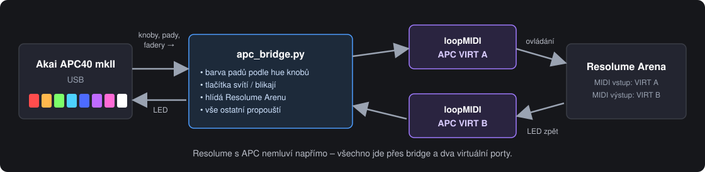
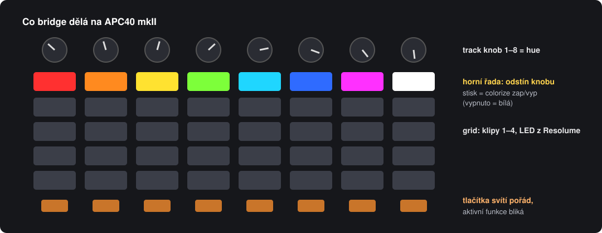
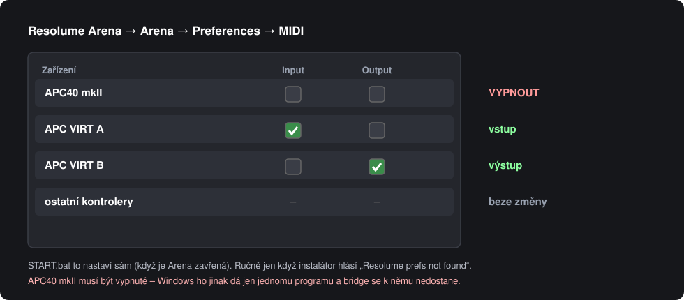
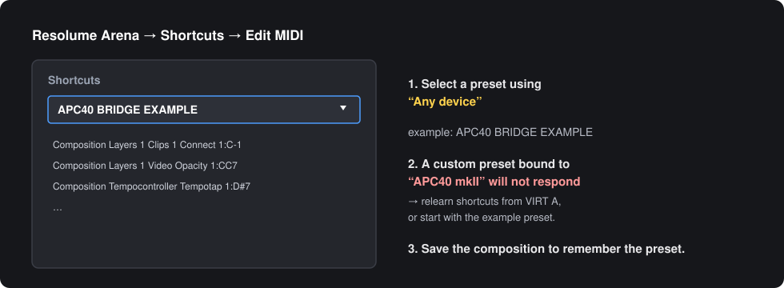
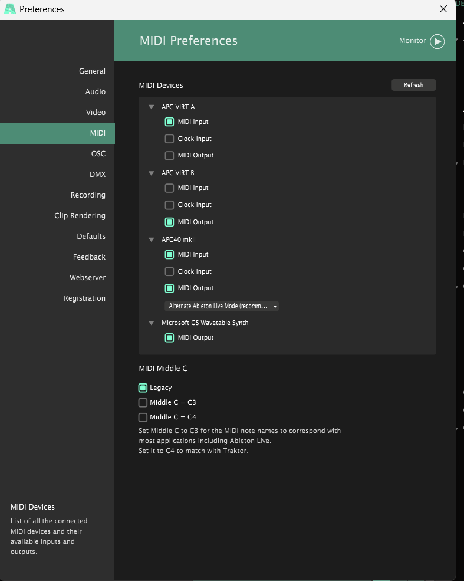
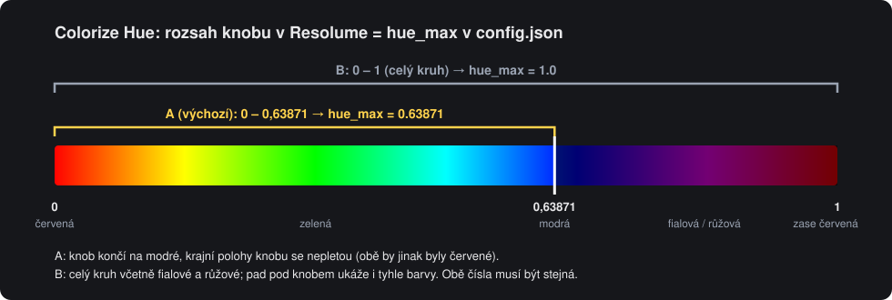
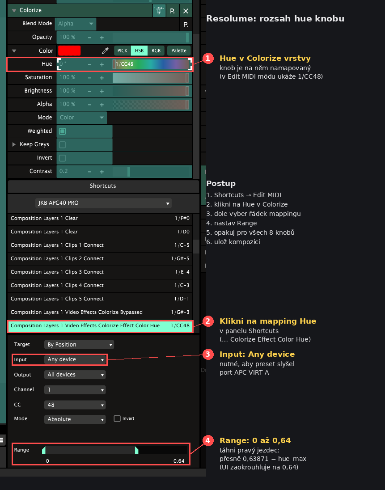

# Setup and troubleshooting guide

[English](navod.md) | [Česky](navod.cs.md) · [Home](../README.md)

## Contents

1. [Requirements](#1-requirements)
2. [Installation and launch](#2-installation-and-launch)
3. [Resolume setup](#3-resolume-setup)
4. [Everyday use](#4-everyday-use)
5. [Bridge configuration](#5-bridge-configuration-configjson)
6. [Troubleshooting](#6-troubleshooting)
7. [Fallback mode and removal](#7-fallback-mode-and-removal)

## 1. Requirements

Windows 10/11 x64, Resolume Arena 7.x (tested with 7.25), and an Akai APC40 mkII connected by USB. The setup EXE includes Python and MIDI libraries. It downloads [loopMIDI](https://www.tobias-erichsen.de/software/loopmidi.html) only if missing; confirm the publisher's license and Windows permission prompts.

## 2. Installation and launch

Follow the [Windows installation guide](windows-installation.md) for the setup EXE, portable ZIP, offline use and updates. Setup prepares **APC VIRT A** (bridge → Arena) and **APC VIRT B** (Arena → bridge), preserves existing profiles and backs up Arena MIDI settings.

If loopMIDI was already running without these ports, restart it once. Open **APC40 Bridge → Start bridge**, then Arena. **Install / repair** repeats preparation; close Arena if its MIDI preferences need changing.

**Start automatically when signing in to Windows** runs the bridge without opening the dashboard. After moving a portable installation, switch this option off and on to update its shortcut. **View logs** shows runtime and setup logs.

## 3. Resolume setup

- **Shortcut input:** use **Any device** or **APC VIRT A** so shortcuts receive the bridge's virtual-port messages.
- Setup copies **APC40 BRIDGE EXAMPLE** into `Documents\Resolume Arena\Shortcuts\MIDI`. See the expected [composition layout](layout.md).
- **Custom mapping:** relearn shortcuts in *Shortcuts → Edit MIDI*. Input from `APC VIRT A` is expected.
- **Top grid row, notes 32–39:** toggles layer Colorize. The bridge owns the pad colors and can update them from optional MIDI feedback.
- **Track knobs, CCs 48–55:** control Colorize Hue over 0–0.63871 (red → green → blue).
- **Save the composition.** It remembers the selected MIDI preset.

### Arena MIDI preferences

Open **Arena → Preferences → MIDI** and check the following when using the bridge:

| Device | MIDI Input | Clock Input | MIDI Output |
|---|---|---|---|
| APC VIRT A | On | Off | Off |
| APC VIRT B | Off | Off | On |
| APC40 mkII (physical USB controller) | On | Off | On |

Keep physical **APC40 mkII MIDI Input and MIDI Output enabled** and select **Alternate Ableton Live Mode** (66 / 0x42). Disabling the physical ports removes feedback in the tested setup.

**Install / repair** preserves the selected control-surface mode; check **Alternate Ableton Live Mode** manually after first setup.

**MIDI Middle C:** the supplied reference uses **Legacy**. This changes displayed note names only, not MIDI note numbers or bridge routing. Leave unrelated MIDI devices as required by your setup; Microsoft GS Wavetable Synth is not needed by the bridge.

Shortcuts should receive from **Any device** or **APC VIRT A**, and send feedback to **All devices** or **APC VIRT B**. If resets reach the controller but Arena keeps an old value, toggle **APC VIRT A → MIDI Input** off and on after starting loopMIDI.

Reference screenshot: where to find these controls

### Hue range: match the knob and pad

Colorize Hue wraps around: 0 is red and 1 is **red again**. Mapping a knob to the full range gives the same color at both ends, with blue somewhere in the middle. The example preset therefore limits the knobs to **0–0.63871**, ending at blue.

The bridge derives pad colors from MIDI values rather than reading the full effect value through an API. **The upper limit in Resolume must match `hue_max` in `config.json`**, otherwise the pad and layer colors can differ.

1. Open *Shortcuts → Edit MIDI*.
2. Click the mapped layer Colorize **Hue** parameter (for example, `1/CC48`).
3. Select the `… Video Effects Colorize Effect Color Hue` entry in **Shortcuts**. Check **Input: Any device**.
4. Under **Range**, set the right handle to **0.64** (rounded display; the example preset stores exactly 0.63871). Leave the left handle at 0.
5. Repeat for all eight Hue knobs, then save the composition.

The difference between 0.64 and 0.63871 is less than half a degree of hue and does not change the pad palette color.

| Desired range | Resolume maximum | `hue_max` |
|---|---|---|
| **A (default):** red → blue, distinct endpoints | `0.63871` | `0.63871` |
| **B:** full circle, including purple and pink | `1` | `1.0` |
| Custom limit | Your value | The same value |

Click **Restart** after changing bridge settings. Mode B also shows purple and pink. Both modes select the closest color in the APC `palette`.

## 4. Everyday use

| Situation | Action |
|---|---|
| Autostart enabled | Open Arena; the APC lights up within a few seconds |
| Autostart disabled | Open the dashboard → Start bridge, then Arena |
| Use the APC in another program | Close Arena to release the APC, or click Stop |
| Something is wrong | View logs; if needed, Install / repair |

**When the bridge starts**, the APC sends all fader and knob positions, and Resolume applies them immediately. A fader physically at the bottom sets its layer opacity to zero.

### LED meanings

| Button | Steady | Blinking |
|---|---|---|
| Top grid row | Hue of the knob above it; white means Colorize is off | — |
| Single-color utility buttons | Function available | Function active: flash held, effect enabled, clip playing, etc. |
| Mute buttons (`lit_invert`) | Normal state | Muted |
| Clip grid | Determined by your Resolume preset | — |

### Top-row feedback

`sync_resolume_feedback: true` enables simple synchronization using existing MIDI feedback. Arena must send Hue and Colorize feedback to `APC VIRT B`. The bridge receives CCs 48–55 on channel 0 (channel 1 in Arena), stores Hue, and updates the pad color. Mouse edits and other controllers can update the same indicator when Arena sends the corresponding messages. `hue_max` must still match the preset range.

Do not interpret Colorize as `velocity > 0`: this preset sends **5 for an active effect** and **3 for bypass**. These values are configured by `color_on_feedback_velocity` and `color_off_feedback_velocity`. White indicates bypass. Re-enabling Colorize restores the remembered hue instead of the plain red from the preset. Unexpected velocities and Note Off are ignored. These feedback messages are not returned to Arena, preventing a MIDI loop.

Limitations: MIDI has 128 steps, may round values, and is limited by shortcut range and routing. This is not a direct REST/OSC read of the full effect value; there is no active polling. Only messages actually sent by Arena update the bridge. Colors outside the mapped range may differ. Composition changes synchronize only if the new composition uses matching mappings and sends feedback. Saturation, brightness, and opacity are not tracked; the pad still displays a fully saturated hue.

For another preset, match the CCs/notes, channel, range, and Colorize feedback values. Set `sync_resolume_feedback: false` and restart to return to APC-only indication. In this mode, physical knobs/pads alone determine the top row; mouse edits do not update it.

### MIDI error recovery

If a port fails to open, the bridge closes previously opened ports and retries. Send errors in either direction or in the blink thread mark the connection as failed; the main loop closes it and reconnects, even if the port names remain listed. Actual USB disconnect behavior should still be checked with the specific device and driver.

Stop and restart share `stop_bridge.ps1`. Before terminating a process, it checks Python, the exact script path, run mode, and process creation time. A stale `bridge.pid` alone cannot terminate an unrelated program.

## 5. Bridge configuration (`config.json`)

| Key | Default | Meaning |
|---|---|---|
| `to_resolume_port` / `from_resolume_port` | `APC VIRT A` / `APC VIRT B` | loopMIDI port names |
| `apc_port_match` | `APC40` | Substring of the physical APC port name in Windows |
| `arena_process` | `Arena.exe` | Process watched by the bridge |
| `knob_ccs` | 48–55 | Track knobs supplying Hue |
| `color_notes` | 32–39 | Pads displaying Hue |
| `hue_max` | 0.63871 | Upper Hue limit; **must match the Resolume knob maximum**; `1.0` = full circle ([Hue range](#hue-range-match-the-knob-and-pad)) |
| `palette` | 14 colors | Hue angle → APC palette number (red → blue → purple → pink) |
| `white_velocity` | 3 | Pad color with Colorize off |
| `sync_resolume_feedback` | `true` in the supplied config, otherwise `false` | Follow Arena Hue/Colorize feedback |
| `color_on_feedback_velocity` / `color_off_feedback_velocity` | 5 / 3 | Feedback values for active Colorize / bypass in this preset |
| `always_lit` | `true` | Keep single-color utility buttons lit |
| `lit_track_notes` / `lit_global_notes` | See file | Buttons to illuminate |
| `lit_invert` | Mute buttons | Steady = normal; blinking = muted |
| `blink_hz` | 3 | Blink rate |
| `apc_mode` | 66 | APC mode (0x42 Alternate Ableton); try 65 if controls do not respond |

Click **Restart** after changing settings.

## 6. Troubleshooting

| Symptom | Cause | Solution |
|---|---|---|
| Setup reports missing ports | loopMIDI has not loaded the required names | Restart loopMIDI; check for `APC VIRT A` and `APC VIRT B` |
| APC stays dark | Bridge or Arena is not running | Check `bridge.log`, click Start bridge, open Arena |
| Log says “Waiting for ports” | APC disconnected or held by another program | Connect USB; close other MIDI apps; verify the tested MIDI preferences above |
| Knobs/pads do nothing in Resolume | Shortcut input misses the virtual port | Use Any device or APC VIRT A |
| Resolume cannot see APC VIRT A | loopMIDI is not running | Start loopMIDI and enable its autostart |
| Setup says Arena is running | MIDI preferences cannot be changed while Arena is open | Close Arena, then use Install / repair again |
| Another controller triggers the same actions | Any device preset hears all enabled inputs | Disable that controller in *Preferences → MIDI* if unwanted |
| Pad and layer colors differ | Missing feedback, disabled sync, or mismatched range | Check `sync_resolume_feedback`, shortcut output to APC VIRT B, and matching `hue_max` ([Hue range](#hue-range-match-the-knob-and-pad)) |
| Knob turns red again at its far end | Knob mapped to the full 0–1 range | Set Resolume maximum to 0.63871, or use `hue_max: 1.0` for the full circle |

Logs are available inside the app: **View logs → Bridge runtime / Setup / App management**.

## 7. Fallback mode and removal

For direct APC control without bridge lighting, click **Stop**, keep physical APC MIDI input/output enabled and use an **Any device** preset.

To restore Arena's original MIDI settings, close Arena and click **Restore Arena MIDI**. This restores `midi.xml.pred-bridge.bak`, stops the bridge and disables its autostart. Remove the installed app through Windows Installed Apps; see [what is retained](windows-installation.md#updates-and-removal).

## Animated group-speed rings

**Leave this experimental option off for normal use.** Ring CC animation can interfere with absolute knob values and cause speed jumps.

With **Settings → Speed rings → Animate speed rings while idle**, the dot bounces first → last → first. The first turn pauses animation and restores the stored value; that movement and a short settling interval are consumed locally. Later movement passes to Arena. Animation resumes after one second idle. Mouse updates require matching Arena MIDI feedback and `sync_resolume_feedback: true`.

Set `speed_ring_animation: false` and restart if control jumps. A hardware-free test cannot establish that encoder interference is fixed.

## Idle-only speed-ring animation and manual takeover

Advanced defaults in `config.json`: CCs `[20,21,22,23]`, channel `0`, out-and-back periods `2.0–0.25` seconds, update rate `120` Hz, idle `1.0` second, settling `0.05` second. The update rate is scheduler frequency, not constant MIDI traffic. See the [Akai protocol](https://cdn.inmusicbrands.com/akai/attachments/apc40II/APC40Mk2_Communications_Protocol_v1.2.pdf) for ring messages.

## Speed buttons: blink rate and 1x reset

Enable **Settings → Speed buttons → Blink speed buttons; press to reset to 1x**, save and restart. This is off by default. It uses the **upper** device-button row beneath knobs 5–8: notes **58–61**, paired with CCs **20–23**, MIDI channel 1 (zero-based 0).

While enabled, button presses/releases replace their original preset actions. Pressing sends the paired CC reset to Arena and the APC and restarts the pulse phase. Knobs keep normal absolute feedback; mouse changes update the indication when Arena sends matching feedback. These LEDs blink on/off, without smooth fading.

### Speed-button range correction

With the supplied **1x–10x** mapping, CC **0 = 1x**, CC **127 = 10x**, and reset sends **0**. Blinking increases from **1 to 3 Hz**, indicating shortcut position rather than measuring Arena's nonlinear speed curve.

| Configuration key | Default |
|---|---|
| `speed_button_pulse` | `false` |
| `speed_button_notes` | `[58,59,60,61]` |
| `speed_button_base_seconds` | `1.0` |
| `speed_button_min_multiplier` / `speed_button_max_multiplier` | `1.0` / `10.0` |
| `speed_button_reset_value` | `0` |
| `speed_button_max_blink_hz` | `3.0` |

Other mappings may need a different reset value. Speed buttons and legacy ring animation cannot run together; saving Settings disables ring animation.

### Arena reset and MIDI routing

If the APC resets but Arena shows an old number, check shortcut input from **Any device** or **APC VIRT A** and feedback to **APC VIRT B** or **All devices**. After recreating a virtual port, toggle its Arena MIDI Input off/on. Keep physical APC input/output enabled as in [MIDI preferences](#arena-midi-preferences), and MIDI learning off during bridge restarts.

For custom lighting and resets, use [Controller Studio](controller-studio.md).
