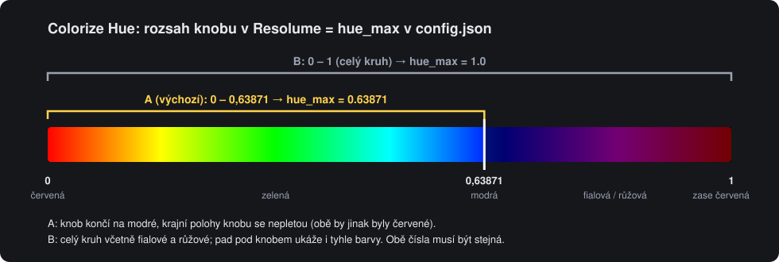
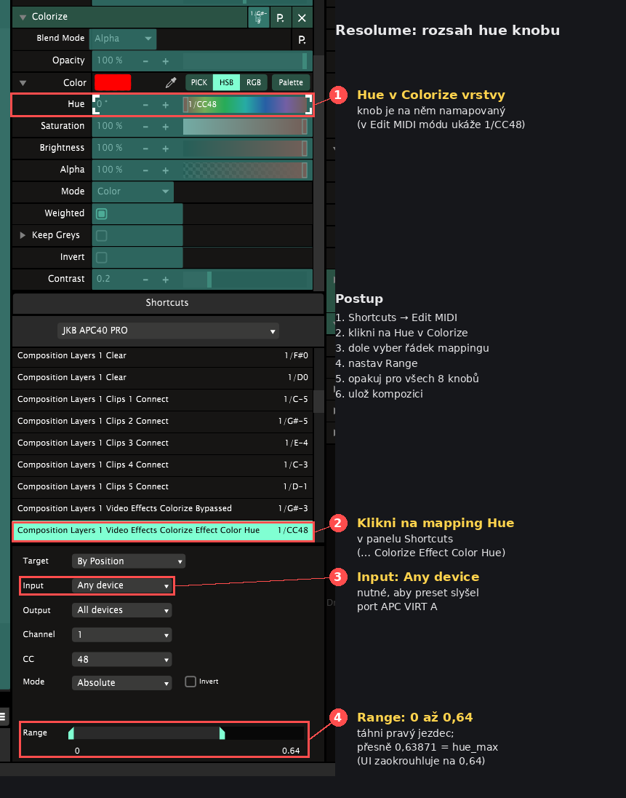

# Setup and troubleshooting guide

[English](navod.md) | [Česky](navod.cs.md) · [Home](../README.md)

## Contents

1. [Requirements](#1-requirements)
2. [Installation and launch](#2-installation-and-launch)
3. [Resolume setup](#3-resolume-setup)
4. [Everyday use](#4-everyday-use)
5. [Bridge configuration](#5-bridge-configuration-configjson)
6. [Troubleshooting](#6-troubleshooting)
7. [Fallback mode and removal](#7-fallback-mode-and-removal)

## 1. Requirements

| Component | Version | Notes |
|---|---|---|
| Windows | 10 / 11 | 64-bit |
| Resolume Arena | 7.x | Tested with 7.25 |
| Akai APC40 mkII | — | Connected via USB |
| Python | 3.9+ | Setup installs 3.12 if missing |
| [loopMIDI](https://www.tobias-erichsen.de/software/loopmidi.html) | — | Setup attempts installation via winget; see the publisher’s license for your use case |
| Internet | — | Needed during initial setup |

## 2. Installation and launch

1. Extract the Windows package into a permanent folder. Close Arena before initial setup.
2. Open **APC40 Bridge.exe**. If using the source ZIP, open **bridge/APC40 Bridge.vbs** to build and open the same dashboard.
3. Click **Prepare and start**. Setup finds or installs Python, MIDI libraries, and loopMIDI.
4. If virtual ports are missing, click **Open loopMIDI**, add **APC VIRT A** and **APC VIRT B**, then repeat setup. Keep loopMIDI autostart enabled.
5. Setup updates Arena MIDI inputs/outputs, saves a backup, and copies the example preset if not already installed.
6. In Arena, use **Any device** for the preset and match the Hue range below.

| Port | Direction |
|---|---|
| APC VIRT A | Bridge → Resolume |
| APC VIRT B | Resolume → bridge |

For normal use, click **Start bridge**. Repeated launches do not create another process. **Start automatically when signing in to Windows** launches the watcher without opening the dashboard or running setup again. After moving the installation folder, turn this option off and on to update its shortcut.

**Install / repair** can be used again; preparation alone does not restart a running bridge. If Arena is running and its MIDI settings need changing, setup asks you to close Arena. Restarting the bridge may send the physical fader and knob positions to the composition.

Setup backs up the original MIDI settings as `midi.xml.pred-bridge.bak`. With Arena closed, **Restore Arena MIDI** restores that backup, stops the bridge, and disables its autostart. Open **View logs** for runtime and installation logs.

## 3. Resolume setup

- **The MIDI preset must use Any device.** A preset bound to APC40 mkII does not respond through the virtual port, because Resolume now receives input from `APC VIRT A`.
- Setup copies **APC40 BRIDGE EXAMPLE** into `Documents\Resolume Arena\Shortcuts\MIDI`. See the expected [composition layout](layout.md).
- **Custom mapping:** relearn shortcuts in *Shortcuts → Edit MIDI*. Input from `APC VIRT A` is expected.
- **Top grid row, notes 32–39:** toggles layer Colorize. The bridge owns the pad colors and can update them from optional MIDI feedback.
- **Track knobs, CCs 48–55:** control Colorize Hue over 0–0.63871 (red → green → blue).
- **Save the composition.** It remembers the selected MIDI preset.

### Hue range: match the knob and pad

Colorize Hue wraps around: 0 is red and 1 is **red again**. Mapping a knob to the full range gives the same color at both ends, with blue somewhere in the middle. The example preset therefore limits the knobs to **0–0.63871**, ending at blue.

The bridge derives pad colors from MIDI values rather than reading the full effect value through an API. **The upper limit in Resolume must match `hue_max` in `config.json`**, otherwise the pad and layer colors can differ.

1. Open *Shortcuts → Edit MIDI*.
2. Click the mapped layer Colorize **Hue** parameter (for example, `1/CC48`).
3. Select the `… Video Effects Colorize Effect Color Hue` entry in **Shortcuts**. Check **Input: Any device**.
4. Under **Range**, set the right handle to **0.64** (rounded display; the example preset stores exactly 0.63871). Leave the left handle at 0.
5. Repeat for all eight Hue knobs, then save the composition.

The difference between 0.64 and 0.63871 is less than half a degree of hue and does not change the pad palette color.

| Desired range | Resolume maximum | `hue_max` |
|---|---|---|
| **A (default):** red → blue, distinct endpoints | `0.63871` | `0.63871` |
| **B:** full circle, including purple and pink | `1` | `1.0` |
| Custom limit | Your value | The same value |

Click **Restart** after changing bridge settings. Mode B also shows purple and pink. Both modes select the closest color in the APC `palette`.

## 4. Everyday use

| Situation | Action |
|---|---|
| Autostart enabled | Open Arena; the APC lights up within a few seconds |
| Autostart disabled | Open the dashboard → Start bridge, then Arena |
| Use the APC in another program | Close Arena to release the APC, or click Stop |
| Something is wrong | View logs; if needed, Install / repair |

**When the bridge starts**, the APC sends all fader and knob positions, and Resolume applies them immediately. A fader physically at the bottom sets its layer opacity to zero.

### LED meanings

| Button | Steady | Blinking |
|---|---|---|
| Top grid row | Hue of the knob above it; white means Colorize is off | — |
| Single-color utility buttons | Function available | Function active: flash held, effect enabled, clip playing, etc. |
| Mute buttons (`lit_invert`) | Normal state | Muted |
| Clip grid | Determined by your Resolume preset | — |

### Top-row feedback

`sync_resolume_feedback: true` enables simple synchronization using existing MIDI feedback. Arena must send Hue and Colorize feedback to `APC VIRT B`. The bridge receives CCs 48–55 on channel 0 (channel 1 in Arena), stores Hue, and updates the pad color. Mouse edits and other controllers can update the same indicator when Arena sends the corresponding messages. `hue_max` must still match the preset range.

Do not interpret Colorize as `velocity > 0`: this preset sends **5 for an active effect** and **3 for bypass**. These values are configured by `color_on_feedback_velocity` and `color_off_feedback_velocity`. White indicates bypass. Re-enabling Colorize restores the remembered hue instead of the plain red from the preset. Unexpected velocities and Note Off are ignored. These feedback messages are not returned to Arena, preventing a MIDI loop.

Limitations: MIDI has 128 steps, may round values, and is limited by shortcut range and routing. This is not a direct REST/OSC read of the full effect value; there is no active polling. Only messages actually sent by Arena update the bridge. Colors outside the mapped range may differ. Composition changes synchronize only if the new composition uses matching mappings and sends feedback. Saturation, brightness, and opacity are not tracked; the pad still displays a fully saturated hue.

For another preset, match the CCs/notes, channel, range, and Colorize feedback values. Set `sync_resolume_feedback: false` and restart to return to APC-only indication. In this mode, physical knobs/pads alone determine the top row; mouse edits do not update it.

### MIDI error recovery

If a port fails to open, the bridge closes previously opened ports and retries. Send errors in either direction or in the blink thread mark the connection as failed; the main loop closes it and reconnects, even if the port names remain listed. Actual USB disconnect behavior should still be checked with the specific device and driver.

Stop and restart share `stop_bridge.ps1`. Before terminating a process, it checks Python, the exact script path, run mode, and process creation time. A stale `bridge.pid` alone cannot terminate an unrelated program.

## 5. Bridge configuration (`config.json`)

| Key | Default | Meaning |
|---|---|---|
| `to_resolume_port` / `from_resolume_port` | `APC VIRT A` / `APC VIRT B` | loopMIDI port names |
| `apc_port_match` | `APC40` | Substring of the physical APC port name in Windows |
| `arena_process` | `Arena.exe` | Process watched by the bridge |
| `knob_ccs` | 48–55 | Track knobs supplying Hue |
| `color_notes` | 32–39 | Pads displaying Hue |
| `hue_max` | 0.63871 | Upper Hue limit; **must match the Resolume knob maximum**; `1.0` = full circle ([Hue range](#hue-range-match-the-knob-and-pad)) |
| `palette` | 14 colors | Hue angle → APC palette number (red → blue → purple → pink) |
| `white_velocity` | 3 | Pad color with Colorize off |
| `sync_resolume_feedback` | `true` in the supplied config, otherwise `false` | Follow Arena Hue/Colorize feedback |
| `color_on_feedback_velocity` / `color_off_feedback_velocity` | 5 / 3 | Feedback values for active Colorize / bypass in this preset |
| `always_lit` | `true` | Keep single-color utility buttons lit |
| `lit_track_notes` / `lit_global_notes` | See file | Buttons to illuminate |
| `lit_invert` | Mute buttons | Steady = normal; blinking = muted |
| `blink_hz` | 3 | Blink rate |
| `apc_mode` | 66 | APC mode (0x42 Alternate Ableton); try 65 if controls do not respond |

Click **Restart** after changing settings.

## 6. Troubleshooting

| Symptom | Cause | Solution |
|---|---|---|
| Setup reports missing ports | Missing or differently named loopMIDI ports | Create exactly `APC VIRT A` and `APC VIRT B` |
| APC stays dark | Bridge or Arena is not running | Check `bridge.log`, click Start bridge, open Arena |
| Log says “Waiting for ports” | APC disconnected or held by another program | Connect USB; disable physical APC40 mkII in Resolume; close Ableton or other MIDI apps |
| Knobs/pads do nothing in Resolume | Preset bound to APC40 mkII | Use Any device (section 3) |
| Resolume cannot see APC VIRT A | loopMIDI is not running | Start loopMIDI and enable its autostart |
| Setup says Arena is running | MIDI preferences cannot be changed while Arena is open | Close Arena, then use Install / repair again |
| Another controller triggers the same actions | Any device preset hears all enabled inputs | Disable that controller in *Preferences → MIDI* if unwanted |
| Pad and layer colors differ | Missing feedback, disabled sync, or mismatched range | Check `sync_resolume_feedback`, shortcut output to APC VIRT B, and matching `hue_max` ([Hue range](#hue-range-match-the-knob-and-pad)) |
| Knob turns red again at its far end | Knob mapped to the full 0–1 range | Set Resolume maximum to 0.63871, or use `hue_max: 1.0` for the full circle |

Logs are available inside the app: **View logs → Bridge runtime / Setup / App management**.

## 7. Fallback mode and removal

**Fallback mode during a show:**

1. Click **Stop** or run `STOP.bat`.
2. In Arena → *Preferences → MIDI*, enable physical **APC40 mkII** input and output.
3. An Any device preset keeps working directly, without the bridge color pads and utility-button lighting.

**Removal:**

1. Disable autostart in the app and click **Stop**.
2. With Arena closed, use **Restore Arena MIDI** to restore the original MIDI settings.
3. Delete the installation folder and any desktop/Start Menu shortcuts you created. Uninstall Python and loopMIDI through Windows if no longer needed.

## Animated group-speed rings

With `speed_ring_animation: true`, device knobs 5–8 show a single dot looping across their 15 ring LEDs. Faster group speed means a faster loop. CCs 20–23 on MIDI channel 1 (zero-based 0) still pass unchanged to Arena. The supplied configuration enables this feature; a missing key or `false` preserves the previous behavior.

Arena must send the matching speed CC feedback to **APC VIRT B** (IAC bus B on macOS). With `sync_resolume_feedback: true`, mouse edits update the stored speed and animation. Incoming ring positions/styles are suppressed for animated knobs, preventing a fight with the animator. With sync disabled, Arena speed feedback is ignored for these rings; physical knob movement still changes their speed.

| Setting | Default | Meaning |
|---|---|---|
| `speed_ring_animation` | true in supplied config; false if absent | Enable animated rings |
| `speed_ring_ccs` | [20, 21, 22, 23] | Device-knob CCs; configurable subset of 16–23 |
| `speed_ring_channel` | 0 | Zero-based MIDI channel |
| `speed_ring_slowest_seconds` | 2.0 | Loop period at CC value 0 |
| `speed_ring_fastest_seconds` | 0.25 | Loop period at CC value 127 |
| `speed_ring_update_hz` | 120 | Scheduler rate; MIDI is sent only when the LED index changes |

Period interpolates linearly between the configured endpoints. The animation is a relative speed indicator, not a beat clock or exact display of a percentage. The JKB preset maps these knobs to group speeds of approximately 25–100%. At the fastest default setting, traffic is at most about 60 CCs/s per ring (240 CCs/s total). A low update rate can skip intermediate LEDs.

Last speed values are stored in `state.json` under `speed`, keyed by channel and CC (e.g. `0:20`). Old state files remain compatible. Until movement or feedback arrives, a missing value starts at the slowest period. Changing speed preserves animation phase. The animation thread stops and joins before ports close; send failures mark the connection unhealthy and trigger normal reconnection.

Protocol: [Akai APC40 mkII Communications Protocol v1.2](https://cdn.inmusicbrands.com/akai/attachments/apc40II/APC40Mk2_Communications_Protocol_v1.2.pdf), pages 24–27. Device ring-style CC = knob CC + 8 (28–31 for knobs 5–8); value 1 selects Single. Fifteen values are selected from single-LED ranges, avoiding the intervening two-LED patterns. Mode 66 (Alternate Ableton) is required so the host owns the LEDs.

Validation: hardware-free tests cover periods, protocol messages, passthrough, mouse-style feedback, sync disabled, old configuration/state, persistence, thread shutdown and animation send failures. Real LED appearance and direct mouse changes in Arena have **not yet been verified on hardware**. No API polling is added: mouse changes require actual matching Arena MIDI feedback and are subject to its mapping/range and 7-bit resolution.

Restart the bridge after changing configuration. To revert, set `speed_ring_animation: false` and restart.
